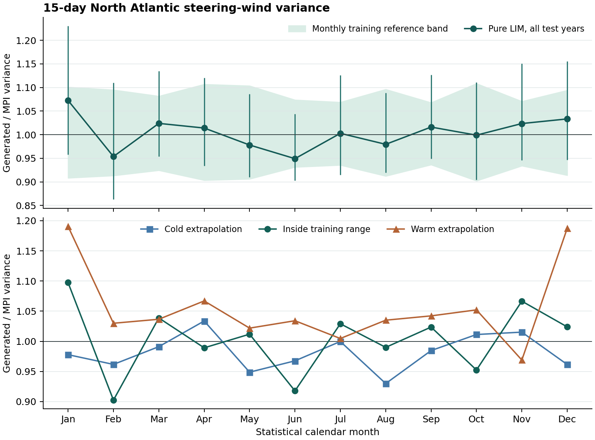

# 全年逐月训练与独立检验结果

全年版已为 1–12 月各拟合空间 EOF、月背景分布、条件风回归、二阶动力矩阵和分布记忆参数。共使用 6,300 个训练成员月，191,870 个实际逐日风场，179,270 组月内连续三日训练样本。验证组 504 个成员月，最终测试组 1,440 个成员月。完整模型的能力按月份判读。

## 合并测试年份

每月用同一批 8 个未参与拟合的成员和 15 个不同于训练、验证的年份，共 120 个成员月。下表是纯 LIM 与 MPI 的引导风方差比，1 表示吻合。5、10、15 天分别有 11、12、12 个月通过本月的训练参考带和独立日对照，三窗口同时通过的有 11 个月。1 月的 5 天方差比为 1.0569，该月参考带为 0.9465–1.0566。四项风场物理界值在 12/12 个月同时满足。

| 月 | 5 天 | 10 天 | 15 天 | 完整月 | 5/10/15 天全部合格 | 四项物理量全部合格 |
|---|---|---|---|---|---|---|
| 1 | 1.057 | 1.072 | 1.073 | 1.170 | 否 | 是 |
| 2 | 0.969 | 0.961 | 0.954 | 0.992 | 是 | 是 |
| 3 | 1.026 | 1.020 | 1.024 | 1.139 | 是 | 是 |
| 4 | 1.028 | 1.020 | 1.014 | 1.050 | 是 | 是 |
| 5 | 1.001 | 0.991 | 0.978 | 1.019 | 是 | 是 |
| 6 | 0.988 | 0.965 | 0.949 | 0.986 | 是 | 是 |
| 7 | 1.021 | 1.015 | 1.003 | 1.028 | 是 | 是 |
| 8 | 1.010 | 1.001 | 0.980 | 1.021 | 是 | 是 |
| 9 | 0.994 | 1.010 | 1.016 | 1.077 | 是 | 是 |
| 10 | 0.994 | 0.996 | 0.999 | 1.092 | 是 | 是 |
| 11 | 1.027 | 1.027 | 1.024 | 1.135 | 是 | 是 |
| 12 | 1.038 | 1.038 | 1.033 | 1.125 | 是 | 是 |

## 温区和对照

三个温区的实际升温跨度为冷端 -0.291 至 -0.020 K，范围内 +1.768 至 +2.247 K，暖端 +3.634 至 +4.424 K。每个温区的留出月份比合并组少，逐月的点估计随选取年份波动。下表均为 15 天方差比。前三列使用各温区自己的 MPI 风作分母，后三列汇总全部测试年份，须与上表同月合并结果比较。TC 傅里叶对照采用发布包的 20 天周期、15 个谐波、独立随机相位和逐小时线性插值，风的空间格点协方差与原始 LIM 匹配。

| 月 | 冷端纯 LIM | 范围内纯 LIM | 暖端纯 LIM | 合并原 LIM | 合并独立日 | 合并 TC 傅里叶 |
|---|---|---|---|---|---|---|
| 1 | 0.978 | 1.097 | 1.191 | 1.115 | 0.749 | 0.784 |
| 2 | 0.962 | 0.903 | 1.030 | 0.990 | 0.683 | 0.716 |
| 3 | 0.991 | 1.039 | 1.037 | 1.060 | 0.699 | 0.735 |
| 4 | 1.034 | 0.989 | 1.067 | 1.040 | 0.675 | 0.714 |
| 5 | 0.949 | 1.012 | 1.022 | 1.009 | 0.610 | 0.649 |
| 6 | 0.968 | 0.918 | 1.034 | 1.006 | 0.574 | 0.612 |
| 7 | 1.000 | 1.029 | 1.005 | 1.026 | 0.644 | 0.685 |
| 8 | 0.930 | 0.990 | 1.035 | 1.074 | 0.671 | 0.717 |
| 9 | 0.985 | 1.024 | 1.042 | 1.117 | 0.697 | 0.742 |
| 10 | 1.011 | 0.952 | 1.052 | 1.079 | 0.663 | 0.703 |
| 11 | 1.015 | 1.067 | 0.969 | 1.076 | 0.686 | 0.726 |
| 12 | 0.962 | 1.024 | 1.187 | 1.085 | 0.703 | 0.740 |

同一测试样本下，按 $|\log R_{15}|$ 衡量两种模型距真实方差的误差。下表第一列计数比较两者点估计，第二列要求“纯 LIM 误差减傅里叶误差”的整个配对 95% 区间都低于零。为核实傅里叶对照的时间统计，我直接调用 TC 原包生成了 1024 组独立相位，每组四条序列。15 天平均保留的风扰动方差比例，原包抽样得 0.08039（蒙特卡洛标准误 0.00015），解析公式得 0.08010。

| 测试温区 | 纯 LIM 的点误差更小 | 配对 95% 区间完全低于零 |
|---|---|---|
| 合并 | 12/12 | 11/12 |
| 冷端 | 12/12 | 4/12 |
| 训练范围内 | 12/12 | 2/12 |
| 暖端 | 10/12 | 0/12 |

暖端的 1 月、12 月出现了相反的排序，纯 LIM 的方差比依次为 1.191、1.187。每个温区各有 40 份测试成员月，表中配对区间按成员和年份重抽样。

## 风场和背景的物理量

每个真实成员月对应两次独立的背景和天气抽样。下表是模型相对 MPI 的最大绝对偏差，同月的原界值依次是 2 m/s、3 m/s、0.4 次/月及 0.2。暖端 3 月的风切变分位绝对偏差为 3.52 m/s，超过 3 m/s 界值。温湿廓线指标使用 600 hPa，海洋面积加权 SST 均值的最大月偏差为 0.071 K。另将 8 月生成的背景和风送入原项目的 Coupled FAST，24 次固定播种有 8 次进入积分，输出 15 天的逐小时轨迹。这一步检查风场接口。自然年输出由独立月份组成，跨月持续性和气旋气候风险需要另行检验。

| 月 | 平均风 (m/s) | 切变分位 (m/s) | 长弱切变次数/月 | 滞后相关 |
|---|---|---|---|---|
| 1 | 0.434 | 1.983 | 0.062 | 0.085 |
| 2 | 0.084 | 1.733 | 0.082 | 0.062 |
| 3 | 0.097 | 2.047 | 0.062 | 0.052 |
| 4 | 0.098 | 1.557 | 0.032 | 0.066 |
| 5 | 0.060 | 1.808 | 0.030 | 0.068 |
| 6 | 0.159 | 1.993 | 0.020 | 0.071 |
| 7 | 0.102 | 1.129 | 0.019 | 0.087 |
| 8 | 0.116 | 0.595 | 0.056 | 0.070 |
| 9 | 0.139 | 1.776 | 0.029 | 0.072 |
| 10 | 0.094 | 1.507 | 0.011 | 0.067 |
| 11 | 0.203 | 2.116 | 0.051 | 0.064 |
| 12 | 0.162 | 1.949 | 0.075 | 0.072 |

## 数据和数值复核

原始资料使用 MPI 的 proleptic Gregorian 日历。训练、验证、测试中分别含有 245、0、32 个闰年 2 月。逐个核过成员年来源、月份、自然日数和传入训练/验证的月文件哈希。12 个横跨训练年代的 9 月与先前独立预处理的物理场复核了掩膜、四分量风、海温、混合层、层结、气压、温度和湿度。训练成员的全球月均气温与独立已归档序列最大差值为 0.000001 K。12 套基础动力矩阵谱半径范围为 0.8482–0.9550，最大相对 Lyapunov 残差为 8.01e-15。

表中的 5/10/15 天判据来自各月训练数据，原 9 月方案与整月重采样的配对非劣效检验另有独立的 9 月结果。本轮将原始 LIM、独立日和 TC 傅里叶作为全年天气对照。[各温区全部窗口和配对区间](annual_lim_scores.csv) · [逐月物理偏差](annual_lim_physics.csv) · [月背景偏差](annual_lim_background.csv) · [拟合参数摘要](annual_lim_fit.csv)
