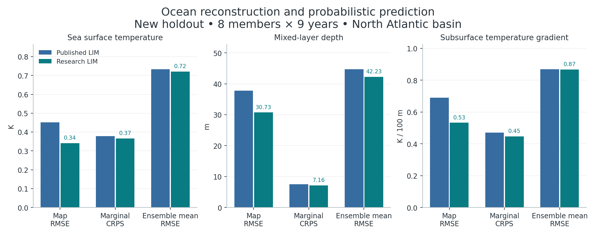
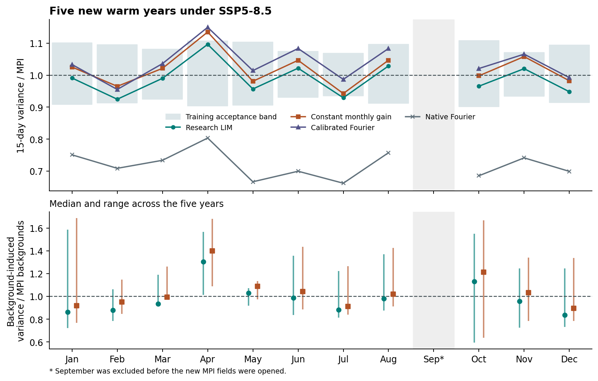
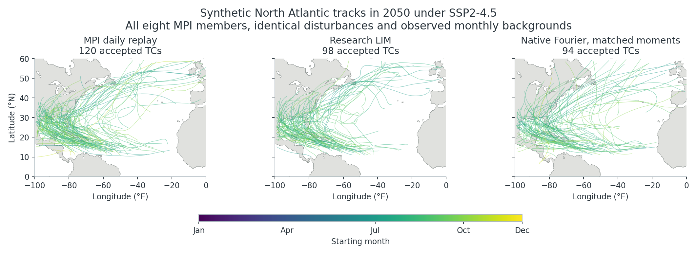
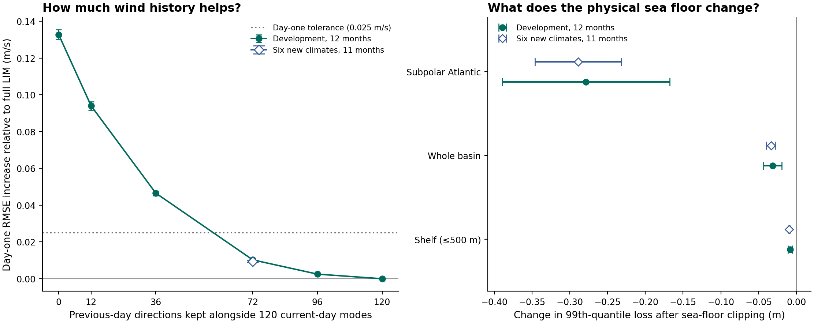

# Refining a North Atlantic ocean and weather emulator

The emulator takes a calendar month, global annual warming above 1850–1900 and a random seed. It generates North Atlantic ocean and atmospheric backgrounds and a history of daily winds. The training archive is MPI-ESM1-2-LR. All twelve calendar months have their own parameters. An annual realization samples each month independently, so the fit describes seasonal changes in distributions and persistence within a month. Storm experiments drive the same Coupled FAST solver with either generated winds or MPI daily winds. [Model and sampling equations](../../experiments/annual_refinement/METHODS.md) · [Annual tutorial](../../notebooks/Annual_Pure_LIM_Tutorial.ipynb) · [Climate panels and score definitions](DATA.md)

## Additional midcentury storms under SSP2-4.5

Across six new complete years and eight held-out members, Research reduces monthly steering RMSE from 0.846 to 0.784 m/s and mixed-layer depth RMSE from 24.27 to 19.20 m. The pooled 48-hour displacement W1 on the MPI monthly background is 29.65 km for v1, 32.98 km for Research and 73.62 km for matched Fourier. Research beats v1 in two individual years. Their pooled paired difference is +3.33 km (95% interval −50.69 to +71.96 km). [Yearly scores, pooled distributions, tracks and replay instructions](midcentury/README.md)

## Results on independent MPI members

The new annual benchmark contains 864 member-months from eight held-out members, nine climate years and all twelve months. The same MPI maps appear on both sides of each comparison below. Wind variance error is the absolute logarithm of the model-to-MPI variance ratio. Every quantity in this table is an error, so a negative paired difference favors the research fit. A 95% interval resamples whole members and years 2,000 times. [Complete new-year table](data/paired_fresh.csv)

| Measure | Published LIM | Research LIM | Paired difference and 95% interval |
| --- | --- | --- | --- |
| SST reconstruction RMSE (K) | 0.452 | 0.341 | -0.111 [-0.114, -0.107] |
| Mixed-layer reconstruction RMSE (m) | 37.81 | 30.73 | -7.08 [-9.86, -5.16] |
| Subsurface-gradient reconstruction RMSE (K per 100 m) | 0.690 | 0.532 | -0.158 [-0.165, -0.151] |
| SST CRPS (K) | 0.378 | 0.366 | -0.012 [-0.015, -0.008] |
| Mixed-layer CRPS (m) | 7.524 | 7.159 | -0.365 [-0.457, -0.274] |
| Subsurface-gradient CRPS (K per 100 m) | 0.470 | 0.446 | -0.024 [-0.027, -0.021] |
| Conditional monthly steering RMSE (m/s) | 0.915 | 0.804 | -0.111 [-0.133, -0.090] |
| 15-day total variance error | 0.035 | 0.024 | -0.010 [-0.016, +0.006] |
| 15-day within-month variance error | 0.032 | 0.042 | +0.009 [-0.011, +0.018] |

The central 90% mixed-layer interval covered 70.7% of new-year MPI values in the published model and 86.8% in the research model. The subpolar mixed-layer reconstruction improved from 105.9 to 86.4 m. In the tropical cyclone corridor it improved from 9.5 to 7.7 m. The remaining error is largest in deep northern mixed layers. The original 15-year test gives mixed-layer RMSE of 33.28 and 26.76 m and conditional monthly steering RMSE of 0.920 and 0.810 m/s. Omitting September from the new panel preserves both improvements. [Regional scores](data/regional_ocean.csv) · [Original annual benchmark](data/paired_test.csv) · [Sensitivity without September](data/paired_fresh_excluding_september.csv)

The arrows run from published to research. Each warming group contains three years. Cold-climate deep mixed layers dominate the absolute error in metres. The largest improvement in conditional monthly steering occurs in the warm group. [Intervals for all three groups](data/paired_fresh.csv) · [Warming-range figure](figures/warming_ranges.png)

| Warming group | Mixed-layer map (m) | Monthly steering (m/s) | 15-day total variance error | 15-day within-month error |
| --- | --- | --- | --- | --- |
| Colder than training | 60.8 → 49.7 | 0.908 → 0.833 | 0.041 → 0.039 | 0.053 → 0.054 |
| Inside training range | 19.7 → 14.9 | 0.853 → 0.782 | 0.073 → 0.059 | 0.047 → 0.054 |
| Warmer than training | 14.2 → 11.7 | 0.980 → 0.796 | 0.072 → 0.068 | 0.053 → 0.042 |

All twelve months pass the original 15-day test when the nine years are pooled. Counting the cold, interior and warm groups separately gives 11, 10 and 6 months for the research LIM, versus 11, 9 and 8 for the published LIM. With the research instantaneous moments the native Fourier passes 0 months in the pooled test and the training-calibrated Fourier passes 9. The corresponding warm-range counts are 0 and 7. In the 2050-only panel the research LIM passes 5 months and the calibrated Fourier passes 6. A pass requires both the original month-specific tolerance and a closer match to MPI than the driver with independent daily weather. [Pass counts by method, panel and temperature](data/multiday_pass_counts.csv)

In the three warmer-than-training years, the research model misses the 15-day tolerance in January, February, April, June, November and December. Its total variance ratios in those months are 0.906, 0.904, 0.872, 1.122, 1.116 and 1.115. All six are closer to MPI than their independent-day control. The variance transmitted from the background, divided by the variance from applying the same regression to actual MPI backgrounds, is 0.73 in February, 0.76 in April and 1.33 in June. Their within-month 15-day ratios are 1.07, 0.96 and 0.97. This identifies the seasonality of the background-to-wind covariance as a concrete next target. The additional five-year confirmation below evaluates one specific calibration. [Individual months and thresholds](data/wind_windows_and_fourier.csv) · [Background variance budget](data/background_to_wind.csv) · [Physical variance curves](figures/background_transfer.png)

Against the training-calibrated Fourier, the new years’ 15-day total variance error is 0.024 for the research LIM and 0.046 for Fourier. For within-month variability the values are 0.042 and 0.038. The three-day, four-component lagged correlation error in the tropical corridor is 0.038 for LIM and 0.078 for calibrated Fourier. Given two previous MPI wind maps and the actual monthly background, day-one steering RMSE is 2.916 m/s for LIM and 3.990 m/s for calibrated Fourier. Their day-15 values are 5.072 and 5.107 m/s. The model’s short-lead advantage and the smaller long-lead differences appear on the same physical scale. [Paired Fourier comparisons](data/paired_fourier_fresh.csv) · [Lag matrices and intervals](data/leadlag_intervals_fresh.csv) · [Conditional forecast figure](figures/conditional_forecasts.png)

## A prospective check on five additional warm years

We sealed one challenger with a constant wind-visible variance gain for each month, then obtained the MPI daily fields for 2081, 2084, 2089, 2095 and 2100. Their warmings span 3.52–4.49 K. These years were absent from the preceding annual comparisons. We reused the eight held-out members and excluded September because early projects had already examined that month. This gives 440 additional member-months. The registered improvement required a strictly negative upper 95% bound on the paired error difference and at least as many passing months. [Timestamped plan and twelve frozen gains](data/warm_confirmation_plan.json) · [Source fields and checksums](data/warm_confirmation_source_datasets.csv)

Both LIMs passed 10 of 11 months. July missed with the research weights (variance ratio 0.929, lower bound 0.936). The gain raised July to 0.943 and moved April from 1.096 to 1.135, above April’s upper bound of 1.107. Mean 15-day total variance error changed from 0.0423 to 0.0413. The paired difference was −0.0010 (95% interval −0.0059 to +0.0272), so the new gain missed its registered improvement criterion. The background-induced variance error increased from 0.1660 to 0.1694. The published research weights remain the selected checkpoint. With the research model’s background and instantaneous moments, calibrated Fourier passed 9 of 11 months and native Fourier passed 0. Their mean errors were 0.0485 and 0.3316 against 0.0423 for the research LIM. The paired LIM-minus-Fourier interval was −0.0456 to +0.0021 for calibrated Fourier and −0.2858 to −0.0551 for native Fourier. [All 11 monthly comparisons](data/warm_confirmation_pass15.csv) · [Paired results](data/warm_confirmation_paired.csv) · [Frozen research LIM versus Fourier](data/warm_confirmation_primary_controls.csv) · [Ocean probabilities](data/warm_confirmation_ocean_paired.csv)

## Tropical cyclones throughout 2050

The MPI SSP2-4.5 warming for 2050 is 1.799 K above 1850–1900. In the field benchmark, mixed-layer map error decreases from 19.70 to 15.28 m and conditional monthly steering error from 0.857 to 0.790 m/s. For the storm table, every wind driver uses the same monthly MPI background, the same eight members and the same 18,432 candidate disturbances. Each W1 distance measures how far an accepted-storm distribution lies from the daily-MPI reference in physical units. [All-month field benchmark](data/paired_ssp245_year.csv) · [Monthly storm scores](data/annual_mpi2050_storms.csv)

| Wind driver | Accepted storms | Storms per 100 attempts | 48-hour displacement W1 (km) | Lifetime-maximum wind W1 (m/s) |
| --- | --- | --- | --- | --- |
| MPI daily winds | 120 | 0.651 | 0 | 0 |
| Published LIM | 120 | 0.651 | 92.1 | 4.87 |
| Research LIM | 98 | 0.532 | 95.5 | 1.52 |
| Native Fourier, published moments | 84 | 0.456 | 221.8 | 2.03 |
| Native Fourier, research moments | 94 | 0.510 | 206.7 | 2.22 |

With matched instantaneous wind moments, the point estimate of the research LIM’s 48-hour improvement over native Fourier is 111 km. Its 95% interval is −44 to +187 km. The published LIM matches the annual reference count of 120 storms and gives a slightly smaller displacement error than the research model. The research fit gives a smaller intensity error when both use MPI backgrounds. With warming as the only climate input, the research fit produces 87 storms and a displacement distance of 125 km, compared with 103 storms and 95 km for the published LIM. In the separate September replay with FaIR warming and more disturbances, the displacement errors are 31.8 km for the published LIM, 161.7 km for the research LIM and 229.8 km for fixed native Fourier. These two experiments use different climate inputs and seeding protocols. The annual experiment describes a single modeled year. [September paired comparison](data/paired_mpi2050.csv) · [All attempted disturbances](data/annual_mpi2050_attempts.parquet) · [Six-hour tracks](data/annual_mpi2050_tracks_6h.parquet)

The annual displacement scores use 103 complete 48-hour windows for MPI, 106 for published v1 and 86 for Research. The paired Research-minus-v1 gap is +3.4 km (95% interval −64.0 to +96.1 km). Aligning the distances from shortest to longest shows where it comes from. The shortest quarter contributes −7.5 km to the change and the other three contribute +3.9, +1.9 and +5.1 km. In July–October, when each driver has windows, using common MPI month shares gives +16.1 km (−41.8 to +152.2). The larger September-only replay has a +63.1 km gap with fixed MPI backgrounds. The tutorial reconstructs the windows from the six-hourly fixes and compares these scores with ocean, steering and storm-intensity errors. [Distribution and quartile contributions](figures/lim_versions_48h.png) · [Executed tutorial, sections 6–8](../../notebooks/FaIR_EOF_LIM_to_Tropical_Cyclones.ipynb)

## What is in the selected checkpoint?

The selected model uses all 57 years of paired training data. For each month it retains 48 SST scores, 72 joint mixed-layer-depth and subsurface-gradient scores, 14 pressure scores and 28 temperature–humidity profile scores. These 162 coordinates determine the monthly background. It represents daily wind with 120 coordinates and stacks two days into a 240-dimensional state. The ocean fit uses log mixed-layer depth and the ordinary training map metric. Separate penalties limit the response of monthly wind to higher-order ocean modes. A warming-dependent amplitude acts on the background directions that together account for at least 55% of the training steering energy. A second ocean covariance fit acts in directions invisible to that regression. The deployment interface takes a calendar month, a warming value and a random seed. [Frozen recipe](recipe.json) · [Compact checkpoint](../../checkpoints/annual_refinement/manifest.json)

## Which changes mattered during development?

The original 15-year experiment supplies 525 maps for each calendar month. With the same 35 members, 30 years supply 1,050 and 57 years supply 1,995. Every added training year falls inside the original warming interval. To isolate the value of additional ocean data, a separate experiment fits the ocean basis with 57 years and keeps the paired winds at 30 years. All 34,020 ocean field maps from the 27 added years agree exactly between the ocean-only and paired preprocessing paths. [Members and years](data/climate_panels.csv) · [Source audit](data/ocean_input_agreement.json)

The completed learning curve compares 6,048 identical held-member/year partitions at each of the 15-, 30- and 57-year data sizes, with 2,016 each for cold, interior and warm splits. For the same reference architecture, moving from 30 to 57 years lowered conditional monthly steering error by 4.01%, 3.01% and 7.92% in those groups. Across all splits the reduction was 4.98%, with lower wind error in 91.3% of them. The mean relative change in ocean CRPS was −0.327%, −0.065% and +0.019% respectively. The 15-to-57-year wind reductions were 12.36%, 11.25% and 21.46%. These percentages average matched split-level changes, with the six ocean CRPS terms weighted equally. The training sets overlap. [All matched steps](data/matched_training_steps.csv) · [Partitions and individual fit scores](data/training_partition_scores.parquet)

* **Mixed-layer map accuracy and probability calibration answer different questions.** A 72-mode training sensitivity gave mixed-layer reconstruction errors of 27.37 m using log depth, 20.06 m using square-root depth and 19.04 m using depth directly. The probabilistic scores were 7.07, 7.17 and 7.49 m in that order. The log transform accommodates a few very deep layers without letting them dominate the fit. Increasing the weight of typically deep cells improved map reconstruction while preserving the physical log-depth sampling law. [Transform and rank comparisons](data/ocean_transform_validation.csv) · [Effect of the number of training years](data/ocean_training_years.csv)
* **A missing spatial pattern can explain a narrow prediction interval.** The published model’s central 90% mixed-layer interval covered 71.2% of validation values. Restoring the covariance of training residual maps brought coverage to 90.5% and CRPS from 7.332 to 7.071 m. The balanced 30-year checkpoint already covered 90.7%. The same additional variance raised coverage to 94.5% and CRPS to 7.194 m from 7.105 m. These are separate validation experiments. [Residual covariance by field and warming](data/unresolved_ocean_variance_validation.csv)
* **Ocean variability reaches the wind through a fitted matrix.** If $C(g)$ describes how background scores vary together at warming $g$, and $K$ maps score anomalies to wind anomalies, the background contribution to the monthly wind covariance is $K^\top C(g)K$. The experiments fit new ocean patterns outside the original leading modes, vary their regression penalty, and adjust selected covariance directions. A direction invisible to the fitted wind can change ocean spread while leaving the background contribution to the wind unchanged. The field tables include the ocean–atmosphere cross terms and a separate contribution from finite-month weather. [Worked two-score example](figures/covariance_to_wind.png) · [Wind variance by field](data/background_to_wind_by_field.csv)
* **Fitting wind persistence gives different gains at different time scales.** A training-only penalty on ordered component covariances lowered the 30-year model’s validation error in directional wind correlations at 1, 3 and 5 days from 0.0194 to 0.0174 in the tropical corridor. Its total variance error over multi-day and monthly averages increased from 0.0445 to 0.0481. The analysis also fits the native Fourier period and spectral exponent on the training winds, giving a stronger control for scalar variance. [Directional tuning](data/training_directional_loss_direction.csv) · [Fitted Fourier spectra](data/training_calibrated_fourier.csv)

At fixed wind regression, a single temperature-dependent amplitude captures much of the validation benefit of varying background covariance. With 57 training years, the mean absolute log error in the total background-induced steering variance was 0.194 for a pooled covariance and 0.176 for a single log-linear amplitude. The corresponding ocean contribution errors were 0.165 and 0.144. Fitting separate amplitudes to each of the four source fields gave a slightly smaller error in the full matrix of contributions, 0.156 versus 0.157, while its total variance error was 0.179. At the warm edge the published response attained 0.099, compared with 0.109 for the single amplitude. The fixed transfer lets these differences be attributed specifically to the warming law. [Six covariance laws at three training sizes](data/fixed_transfer_covariance_validation.csv)

Giving the 57-year forecast candidate and both Fourier controls the same two previous wind maps adds a prediction test in physical units. On validation members, the one-day steering RMSE was 2.93 m/s for LIM, 4.00 m/s for training-calibrated Fourier and 4.91 m/s for native Fourier. The paired LIM-minus-calibrated-Fourier difference was −1.071 m/s (95% interval −1.102 to −1.040). At day 15 it was −0.032 m/s. These forecasts use the actual monthly background. [Two-day initialization and the conditional prediction equation](../../experiments/annual_refinement/METHODS.md) · [Validation forecasts](data/two_day_forecasts_val.csv)

The seasonal validation replay uses July, September and November in each of six years. From the same 24,192 disturbances, the daily-MPI reference produces 262 storms, research LIM 249, published LIM 225 and native Fourier 237. The 48-hour displacement distances to MPI are 51.4, 77.5 and 166.9 km for the three generated wind drivers. The all-month 2050 results above provide a separate climate and seeding realization. [Seasonal paired scores](data/paired_seasonal_storms.csv) · [Seasonal track maps](figures/validation_seasonal_tracks.png)

### Reconstructing ocean fronts at fixed rank

At fixed rank, emphasizing mapped ocean fronts helps where the training climatology changes fastest. On 504 development-validation member-months, the strongest front weight reduced the local reconstruction RMSE for SST, mixed-layer depth and subsurface gradient by 3.29%, 3.23% and 3.26%. Basin-wide, mixed-layer RMSE fell 2.10% (95% interval −3.29% to −0.62%), while SST and subsurface-gradient RMSE rose 0.66% and 0.65%. The same 48 SST and 72 joint ocean coordinates were available to each fit. These results quantify the regional cost of changing the training metric. [Map and paired intervals](figures/ocean_front_weighting.png) · [Physical scores](data/ocean_front_validation.csv)

We then refit the background-to-wind regression for each front weight, keeping its penalty, ranks and daily weather common across all three fits. Increasing the weight from zero to one changed conditional monthly steering RMSE from 0.79902 to 0.79909 m/s (paired change +0.00007 m/s, 95% interval −0.00014 to +0.00030). The six validation years’ fixed-climate 15-day variance error rounded to 0.11077 in both fits. The local improvements in the maps transferred very little into these wind statistics. [Equal-rank circulation experiment](data/front_circulation_validation.csv) · [Monthly steering intervals](data/front_circulation_wind_intervals.csv)

The high end of mixed-layer depth gives another test of the log transform. On the subpolar validation grid, MPI depths exceeded 2,000 m on 0.108% of the area-weighted member-month observations. The published fit predicted 0.022%, and the research fit 0.103%. Above 3,000 m, MPI gave 0.026% and the research fit predicted 0.050%. At the 99th percentile, limiting generated depth to each cell and month’s largest training value lowered the subpolar quantile loss from 2.218 to 1.915 m (paired difference −0.303 m, 95% interval −0.418 to −0.188). Observations still exceeded both estimates on 2.89% of cases against a 1% target. The training ceiling is a statistical control. The released decoder uses the unbounded lognormal upper tail. [Deep-layer validation scores](data/deep_mixed_layer_validation.csv) · [Paired intervals](data/deep_mixed_layer_validation_intervals.csv)

### A training-only test of calendar smoothing

Using 42 years absent from the original fit, we asked whether a month's neighbors help estimate the slope of background-induced wind variance against warming. In 1,728 matched splits, each comparison withheld both members and years. With 28 fitting years and 28 members, the mean warm-edge absolute log error was 0.180 for independently fitted monthly slopes, 0.176 for a cyclic smoothing penalty of one, and 0.204 for constant variance. For the ocean contribution alone, the three scores were 0.195, 0.190 and 0.192. At the cold edge constant variance gave the lowest error for both targets. With only 12 fitting years and 14 members, warm-edge total error fell from 0.210 to 0.186 under the same smoothing. Seasonal smoothing helped most with scarce data. This follow-up used the published spatial basis and wind transfer. The released model predates the trial. [Results by data size and warming](data/seasonal_covariance_training_cv.csv) · [All paired monthly scores](data/seasonal_covariance_training_folds.parquet) · [Warming-range comparison](figures/seasonal_warming_slopes.png)

We also tested the gain on the actual 162-dimensional research background. Its wind-visible subspace is the span of the whitened wind-regression columns. Scaling noise there by the square root of a positive gain scales the entire transmitted wind covariance by that gain. Fitting this correction to the 35 training members reduced development-validation transmitted variance error from 0.1735 to 0.1689 with smoothed slopes. The 15-day total error fell from 0.1117 to 0.1105. For the single warm validation year the transmitted error fell from 0.1271 to 0.0987; for four interior years it rose from 0.1729 to 0.1777. A constant gain per calendar month already gave 0.1693 overall and 0.0943 in the warm year. Mixed-layer CRPS moved from 7.033 to 7.030 m with smoothing. The constant monthly gain became the single challenger in the five-year confirmation. [Gain fits and slopes](data/wind_visible_gain_fits.csv) · [Wind scores by warming](data/wind_visible_gain_wind_validation.csv) · [Ocean scores](data/wind_visible_gain_ocean_validation.csv)

## How much of yesterday’s wind does the LIM need?

Each day has 120 wind EOF coefficients. The released research checkpoint carries the current coefficients and those from the previous day, giving a 240-dimensional state. We projected the dynamics onto the current day alone while preserving its variance and its covariance with tomorrow exactly. Across 504 development member-months, day-one steering RMSE increased from 2.929 to 3.061 m/s with the same output filter. Fitting the filter again on the 57 training years gave 3.091 m/s. The latter reduced 15-day total variance error from 0.1117 to 0.1102 and increased within-month error from 0.0777 to 0.0806. At a 15-day forecast lead the change in steering RMSE was under 0.006 m/s. Most of the benefit of keeping the second day appears at short leads. [Paired forecast errors](data/lim_order_validation_forecasts.csv) · [Wind variance at fixed warming](data/lim_order_validation_windows.csv)

We then ranked previous-day directions by how much they predict about tomorrow after accounting for today. The order comes from the frozen training model. All 120 current-day modes remain. Retaining 12, 36, 72 or 96 previous-day directions gave day-one development RMSEs of 3.023, 2.975, 2.939 and 2.931 m/s. A 192-dimensional state, with 72 previous-day directions, was the smallest tested configuration to meet the prespecified 0.025 m/s tolerance and both 15-day variance tolerances. Its paired day-one increase was 0.0103 m/s (95% interval 0.0097–0.0109). This fixed the single compact model for the separate six-climate test. [Rank-by-rank comparisons](data/partial_wind_memory_summary.csv) · [Conditional projection equations](../../experiments/annual_refinement/METHODS.md)

### Prospective confirmation in six more climates

We registered the compact wind model and a separate mixed-layer-depth correction before acquiring six more MPI annual climates. From previously unused annual years we picked two cold years, two inside the training range, and two warm years using global temperature alone. Eight held-out members and eleven months per year gave 528 new member-months. The new climates are 1864, 1887, 2005, 2061, 2086 and 2094. Their warming spans −0.079 to +4.168 K. [Registered endpoints, years and model hashes](data/compact_ocean_confirmation_plan.json) · [Scored files and checksums](data/compact_ocean_confirmation_source_hashes.csv)

The 192-state wind model increased day-one steering RMSE from 2.9559 to 2.9653 m/s. The change was +0.0094 m/s (paired 95% interval +0.0089 to +0.0100), with increases of +0.0098, +0.0096 and +0.0089 in the cold, interior and warm years. The absolute log errors in total and within-month 15-day variance increased by 0.00006 and 0.00013. All three changes met the tolerances registered from development. The simpler analytic explanation and lowest day-one error still belong to the original two-day state. The 192-state conversion is available when a smaller wind matrix matters. [Paired results](data/compact_ocean_confirmation_paired.csv) · [Window scores](data/compact_ocean_confirmation_window_summary.csv) · [Deployment commands](../../experiments/annual_refinement/README.md)

We also timed 64 simultaneous 31-day wind histories on CPU. Each of the 84 same-node pairs used one BLAS thread and included the 20-day filter warm-up with the matrix factors already in memory. The compact/full median time ratio was 0.722 (interquartile range 0.716–0.727). Median propagation times were 16.1 and 22.3 ms. The three latent covariance and transition arrays occupy 884,736 bytes for the compact state and 1,382,400 bytes for the full state. These timings cover wind propagation. Preparing inputs, mapping winds to grid cells, computing thermodynamics and integrating cyclones have their own costs. [Paired CPU calls](data/compact_runtime_measurements.csv) · [All twelve months](data/compact_runtime_by_month.csv)

The physical correction caps each sampled mixed-layer depth at the MPI model’s local sea-floor depth. All trained wet cells had mapped depths. In development it reduced subpolar 99th-quantile loss from 2.218 to 1.940 m. In the separate six climates the same loss fell from 2.716 to 2.427 m, a change of −0.289 m (95% interval −0.346 to −0.231). Basin loss fell from 0.727 to 0.694 m and shelf loss from 0.200 to 0.190 m. In those MPI samples no observed mixed layer crossed the mapped bottom, whereas the original decoder put 0.201% of its shelf probability below the bottom. This output correction eliminates those crossings. The capped model still underpredicts subpolar depths exceeding 2,000 m, assigning 0.106% against MPI’s 0.181%. The wind regression uses the original background coordinates and is unaffected by this physical decoder option. [Development comparison with the training maximum](data/bathymetric_mld_validation.csv) · [Independent physical tail scores](data/compact_ocean_confirmation_ocean_summary.csv) · [Source depth grid and license](data/mpi_bathymetry_source.json)

## How the comparison is scored

The seven validation members supplied six years of data for screening methods. The primary selection gave equal weight to ocean CRPS, conditional monthly steering RMSE, total multi-day variance error and within-month variance error, each normalized to the published result. Cold- and warm-range checks, short and long forecast leads, shear and lag errors guard against single-metric improvements. Among the eligible fits within 0.006 of the minimum composite score, the smallest state wins. One numerical checkpoint for each month is fixed before the independent scores are computed. [Model selection table](data/model_selection.csv) · [Frozen monthly identifiers](freeze_receipt.json)

The new annual evaluation uses eight separate MPI members and three years in each of three warming ranges. It spans the cold and warm sides of the fixed training interval, approximately −0.012 to 3.420 K. Original and new annual tests use the same eight members in different years. Some years appeared in an earlier September-specific study, so the new annual analysis is also available with September removed. A separate all-month SSP2-4.5 test holds the calendar year at 2050. Its bootstrap resamples the eight members of that year, carrying all of each member’s months and synthetic storms together. [Nine-year results](data/paired_fresh.csv) · [Eleven-month sensitivity](data/paired_fresh_excluding_september.csv) · [2050 results](data/paired_ssp245_year.csv)

## Reproduce the experiment

An independent training run rebuilt all twelve monthly weight identifiers exactly in 798 seconds from the prepared MPI fields and published reference. After extracting the full release into a new directory without any training data, the standard sampling command reproduced an entire 365-day physical output exactly, including all 3,048,480 wind values. The separate 2052 PyTorch CPU run produced all 366 days. The 5.57 MB minimal source package also reproduced all 84 checked physical arrays from one raw MPI member-year and rebuilt the same twelve frozen models in 543 seconds from prepared fields. [Independent refit](data/independent_retraining.json) · [Refit from extracted minimal source](data/minimal_refit_check.json) · [Exact standalone sample](data/standalone_release_check.json) · [Calendar checks](data/portable_calendar_checks.json)

Restore the research checkpoint from the published monthly weights and the twelve compact differences. The data preparation and fitting commands can rebuild it from the MPI climate archive. The two notebooks include the physical inputs, quantitative examples and track plots. The ledger records the experiments in UTC, including alternatives that worsened a score. [Restore, retrain and rerun](../../experiments/annual_refinement/README.md) · [English linear algebra](../../experiments/annual_refinement/METHODS.md) · [Experiment journal](JOURNAL.zh.md) · [Full event ledger](data/events.jsonl.gz)

The converter generated all twelve 192-state weights and ran the normal sampler for an entire 2050 year. Applying the sea-floor bound changed three monthly grid cells in that seeded year. All 3,048,480 wind values and the other physical fields were bit-identical before and after the depth correction. A February NumPy and PyTorch CPU comparison gave identical wind values. [Compact deployment replay](data/compact_deployment_check.json)
