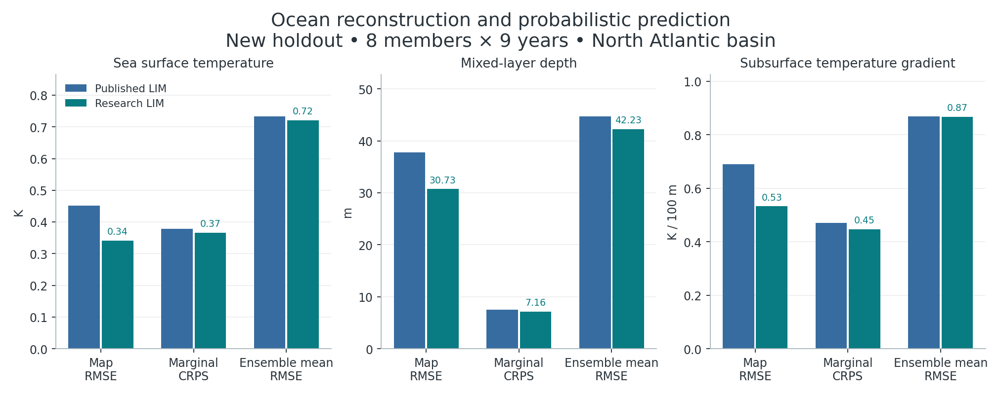
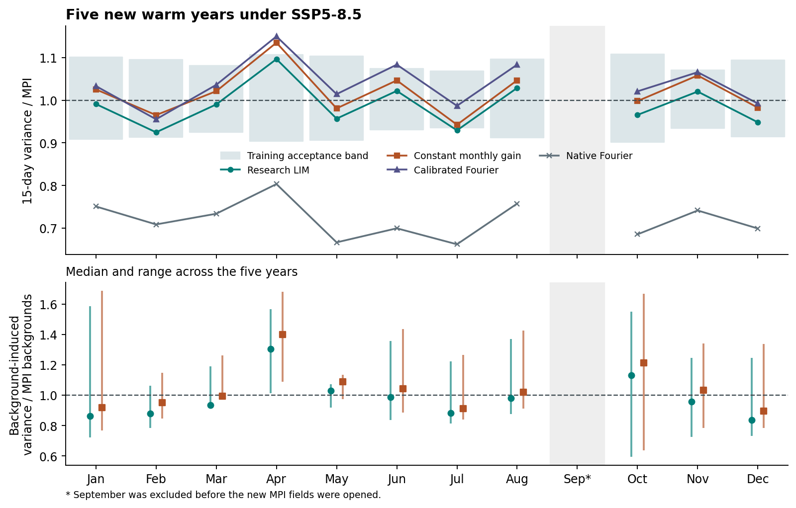
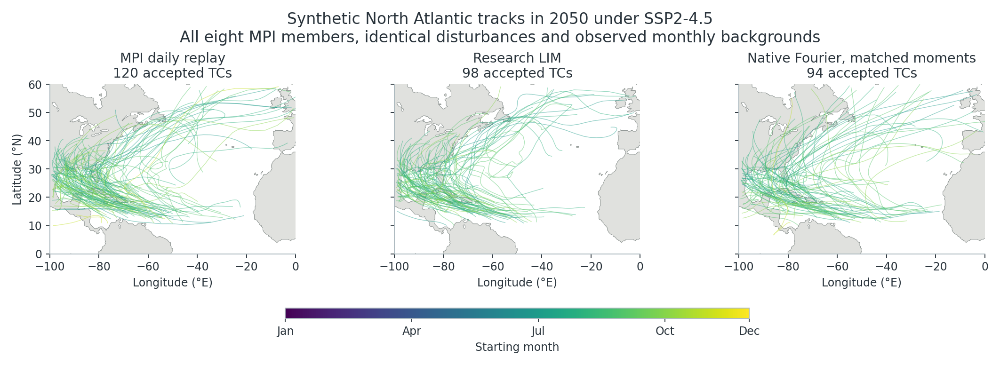

# 北大西洋海洋 EOF 与纯 LIM 的改进实验

这里的目标是给定一个月份和相对 1850–1900 年的全球年度升温，生成这个气候条件下北大西洋可能出现的环境。输入一个随机种子就能重现一次抽样。模型有 12 套逐月参数，1 月至 12 月分别训练。连续生成一年时，每月重新抽取背景并初始化日风，因此跨月风场的逐日衔接未经过训练。[全年教程](../../notebooks/Annual_Pure_LIM_Tutorial.ipynb) · [FaIR 到气旋的教程](../../notebooks/FaIR_EOF_LIM_to_Tropical_Cyclones.ipynb)

## 独立 MPI 成员上的结果

新增全年评估共有 8 个留出成员、9 个年份、12 个月，即 864 个成员月。下表各行都是误差，差值等于改进版减原版，负数表示误差下降。15 天方差误差取模型与 MPI 方差比的对数绝对值。95% 区间通过配对重抽成员和年份 2,000 次得到。[完整数表](data/paired_fresh.csv)

| 指标 | 原版 LIM | 改进 LIM | 配对差及 95% 区间 |
| --- | --- | --- | --- |
| 海表温度重建 RMSE（K） | 0.452 | 0.341 | -0.111 [-0.114, -0.107] |
| 混合层深度重建 RMSE（m） | 37.81 | 30.73 | -7.08 [-9.86, -5.16] |
| 次表层梯度重建 RMSE（K/100 m） | 0.690 | 0.532 | -0.158 [-0.165, -0.151] |
| 海表温度 CRPS（K） | 0.378 | 0.366 | -0.012 [-0.015, -0.008] |
| 混合层深度 CRPS（m） | 7.524 | 7.159 | -0.365 [-0.457, -0.274] |
| 次表层梯度 CRPS（K/100 m） | 0.470 | 0.446 | -0.024 [-0.027, -0.021] |
| 条件月均引导风 RMSE（m/s） | 0.915 | 0.804 | -0.111 [-0.133, -0.090] |
| 15 天总方差误差 | 0.035 | 0.024 | -0.010 [-0.016, +0.006] |
| 15 天月内方差误差 | 0.032 | 0.042 | +0.009 [-0.011, +0.018] |

原版混合层的 90% 区间覆盖新年份中 70.7% 的格点样本，改进后达到 86.8%。亚极地混合层的重建误差从 105.9 降至 86.4 m，热带气旋走廊从 9.5 降至 7.7 m，北部深混合层仍最难还原。原来的 15 年测试也得到相同方向的结果，混合层误差从 33.28 降至 26.76 m，条件月均引导风误差从 0.920 降至 0.810 m/s。把 9 月从新增测试中去掉，海洋和月均风改善依然存在。[分区结果](data/regional_ocean.csv) · [原全年测试](data/paired_test.csv) · [去掉 9 月的检验](data/paired_fresh_excluding_september.csv)

按温区拆开后，箭头左边是原版，右边是改进版。每个温区各有 3 年。冷端深混合层的误差以米计最大，条件月均风改善最明显的是暖端。[分温区配对区间](data/paired_fresh.csv) · [温区图](figures/warming_ranges.png)

| 温区 | 混合层重建（m） | 条件月均风（m/s） | 15 天总方差误差 | 15 天月内方差误差 |
| --- | --- | --- | --- | --- |
| 冷端外推 | 60.8 → 49.7 | 0.908 → 0.833 | 0.041 → 0.039 | 0.053 → 0.054 |
| 训练范围内 | 19.7 → 14.9 | 0.853 → 0.782 | 0.073 → 0.059 | 0.047 → 0.054 |
| 暖端外推 | 14.2 → 11.7 | 0.980 → 0.796 | 0.072 → 0.068 | 0.053 → 0.042 |

把 9 年合在一起，原版和改进版均有 12/12 个月通过 15 天标准。单看冷端、训练范围内和暖端，改进版通过 11、10、6 个月，原版为 11、9、8。用改进后的瞬时风矩，原生傅里叶在合并评估中通过 0 个月，训练校准傅里叶通过 9 个月；暖端则分别通过 0 和 7 个月。只看 2050 年，改进 LIM 通过 5 个月，校准傅里叶通过 6 个月。通过标准要求方差比落在原先训练得到的容许范围内，并比具有相同背景和瞬时风矩、逐日独立的采样更接近 MPI。[逐月通过数](data/multiday_pass_counts.csv)

暖端没通过的月份是 1、2、4、6、11、12 月，15 天总方差与 MPI 的比值依次为 0.906、0.904、0.872、1.122、1.116 和 1.115。六个月都比逐日独立的对照更接近 MPI，失败发生在原先规定的容许区间。再分解背景项，2 月与 4 月的背景传递方差只有把同一回归用于真实 MPI 背景所得到方差的 0.73 和 0.76 倍，6 月则为 1.33 倍。相应的月内 15 天方差比是 1.07、0.96、0.97。下一轮最值得优先验证的是月均风可感知的背景协方差怎样随季节和升温变化，尤其是这三个偏差方向相反的月份。下面的五个新暖年检验了一种具体的校正。[每月方差与容许范围](data/wind_windows_and_fourier.csv) · [背景分解](data/background_to_wind.csv) · [实际 MPI 背景与模型方差曲线](figures/background_transfer.png)

新年份上，LIM 与训练校准傅里叶的 15 天总方差误差分别为 0.024 和 0.046，月内方差误差分别为 0.042 和 0.038。在热带走廊，四个风分量的三天滞后相关误差分别为 0.038 和 0.078。给相同的两天历史风和当月背景，次日引导风 RMSE 分别为 2.916 和 3.990 m/s；到第 15 天则为 5.072 和 5.107 m/s。短期风的演变是 LIM 优势最清楚的地方。[与傅里叶的配对结果](data/paired_fourier_fresh.csv) · [滞后相关检验](data/leadlag_intervals_fresh.csv) · [条件预测图](figures/conditional_forecasts.png)

## 再用五个新暖年检验一次

我们先锁定每个月一个方差增益和判断标准，随后才读取 2081、2084、2089、2095、2100 年的 MPI 逐日场。这五年的升温为 3.52–4.49 K，先前的全年评估均未使用。评估仍用原来的 8 个留出成员，9 月曾用于早期单月研究，因此本次比较其余 11 个月，共 440 个成员月。事先定下的提升门槛是：15 天总方差误差配对差的 95% 上界小于零，同时通过的月份数至少与冻结版一样多。[提前登记的方案和 12 个增益](data/warm_confirmation_plan.json) · [MPI 源数据与校验码](data/warm_confirmation_source_datasets.csv)

冻结版和校正版都是 10/11 个月通过。冻结版只有 7 月稍低，方差比为 0.929，下限为 0.936。校正后 7 月升到 0.943，可以通过；4 月却从 1.096 升到 1.135，超过上限 1.107。15 天总方差误差从 0.0423 降到 0.0413，配对差为 −0.0010，95% 区间为 −0.0059 到 +0.0272。背景传递方差误差也从 0.1660 变为 0.1694。这种简单增益没有达到预先定下的改善门槛，发布时保留原来的 57 年模型。在冻结版相同背景和瞬时风矩下，训练校准傅里叶通过 9/11，TC 包原生傅里叶通过 0/11。纯 LIM、校准傅里叶、原生傅里叶的误差分别为 0.0423、0.0485、0.3316。LIM 减去校准傅里叶的配对区间为 −0.0456 到 +0.0021，而减去原生傅里叶的区间为 −0.2858 到 −0.0551。前面三暖年的 6/12 与这次五暖年的 10/11 是两批不同年份的结果，两个都保留。[每月方差比与阈值](data/warm_confirmation_pass15.csv) · [配对不确定性](data/warm_confirmation_paired.csv) · [冻结 LIM 和傅里叶](data/warm_confirmation_primary_controls.csv) · [海洋概率结果](data/warm_confirmation_ocean_paired.csv)

## 2050 年全年的气旋回放

SSP2-4.5 的 MPI 训练成员给出的 2050 年全球升温为 1.799 K。在该年的留出成员上，混合层重建误差由 19.70 降到 15.28 m，条件月均风误差由 0.857 降到 0.790 m/s。下面把所有风驱动放进同一套 FAST，使用 8 个成员、每月相同的 MPI 背景和相同的初始扰动，每种驱动全年共 18,432 次。W1 距离比较被接纳气旋的分布，单位与所比较的物理量相同。[2050 环境场指标](data/paired_ssp245_year.csv) · [逐月气旋指标](data/annual_mpi2050_storms.csv)

| 风驱动 | 接纳的气旋 | 每百次扰动 | 48 小时位移 W1（km） | 最大强度 W1（m/s） |
| --- | --- | --- | --- | --- |
| MPI 逐日风 | 120 | 0.651 | 0 | 0 |
| 原版 LIM | 120 | 0.651 | 92.1 | 4.87 |
| 改进 LIM | 98 | 0.532 | 95.5 | 1.52 |
| 原生傅里叶，原版风矩 | 84 | 0.456 | 221.8 | 2.03 |
| 原生傅里叶，改进风矩 | 94 | 0.510 | 206.7 | 2.22 |

在瞬时风矩也配对的情况下，改进 LIM 的 48 小时位移误差比原生傅里叶小 111 km，95% 区间为 −44 到 +187 km。原版 LIM 正好复现全年 120 个气旋，其位移也比改进版略接近 MPI；改进版的最大强度分布误差更小。如果只给升温，让模型自己抽背景，改进版形成 87 个气旋，48 小时位移误差 125 km，原版分别是 103 个和 95 km。在单独的 9 月大样本回放中，使用 FaIR 升温时，原版、改进版和固定原生傅里叶的位移误差分别为 31.8、161.7 和 229.8 km。全年和 9 月试验使用的背景输入与扰动数不同。这个 2050 试验只覆盖一个模拟年份。区间重抽该年的 8 个成员，每个成员的月份和气旋一起保留。[9 月配对试验](data/paired_mpi2050.csv) · [全年全部扰动](data/annual_mpi2050_attempts.parquet) · [六小时轨迹](data/annual_mpi2050_tracks_6h.parquet)

全年可用于 48 小时位移比较的完整轨迹窗，MPI、原版和新版分别有 103、106 和 86 个。新版相对原版的误差增加 3.4 km，配对 95% 区间为 −64.0 至 +96.1 km。把位移从短到长排列，最短四分之一使总误差减少 7.5 km，其余三段分别增加 3.9、1.9 和 5.1 km。在三个驱动都有完整窗口的 7–10 月，把各月权重统一成 MPI 的月份占比后，两版误差差值为 +16.1 km，区间为 −41.8 至 +152.2 km。单独的大样本 9 月回放使用另一组扰动，在相同 MPI 月背景下新版误差增加 63.1 km。教程从六小时位置重算了这些分布，并列出海洋、引导风和气旋强度的变化。[位移分布与各分位段的贡献](figures/lim_versions_48h.png) · [已执行的英文教程第 6–8 节](../../notebooks/FaIR_EOF_LIM_to_Tropical_Cyclones.ipynb)

## 实际交付的模型

最终选择了 57 年完整海气配对的方案。每个月保留海表温度 48 个系数、混合层深度与次表层梯度合计 72 个、海平面气压 14 个、温度湿度廓线合计 28 个，共 162 个背景系数。日风有 120 个系数，最近两天合起来构成 240 维天气状态。海洋采用对数混合层深度与常规空间权重。回归时对高阶海洋系数施加更强的约束，升温响应集中在合计能够解释至少 55% 训练引导风能量的背景方向。另一次海洋协方差修正在风回归看不到的方向调整分布宽度。部署只需训练好的权重、日期、升温和随机种子。[最终配置](recipe.json) · [权重校验清单](../../checkpoints/annual_refinement/manifest.json)

## 训练资料多了什么

原来每个日历月有 35 个成员、15 个年份，共 525 个样本。扩充到 30 年和 57 年后，每月分别有 1,050 和 1,995 个完整的海气样本。新增年份都在原来的升温范围内。另做了一组控制实验，海洋资料增至 57 年，配对风仍用 30 年，以便看清单独增加海洋资料的作用。后补的 27 年资料走两条独立的预处理路径，35 个成员、12 个月、3 个海洋变量，共 34,020 张图，海陆掩膜和有效格点值逐格相同。[资料清单](data/climate_panels.csv) · [格点核验](data/ocean_input_agreement.json)

## 海洋场为什么会变好

混合层深度有两种容易混在一起的误差。第一种给模型一张真实海图，先将它压缩成少数 EOF 系数，再还原，看丢了多少细节。第二种只告诉模型升温，要求它给出有可能出现的深度分布，再看真实深度落在什么位置。前者是重建，后者是概率预测。它们都用米评价。[指标和单位](DATA.md)

在 72 模态的验证试验中，直接拟合深度的重建误差为 19.04 m，拟合平方根为 20.06 m，拟合对数为 27.37 m。概率预测的排序刚好相反，三个 CRPS 分别为 7.49、7.17、7.07 m，越小越好。另一种办法保留对数变换，适度增加深混合层格点在 EOF 拟合中的权重。这能让通常较深的格点对基底的影响更大，同时仍在取指数后评价物理深度。[变换试验](data/ocean_transform_validation.csv) · [训练年份试验](data/ocean_training_years.csv)

一个更直观的问题是，模型说真实深度有 90% 的机会落在上下限之间，实际覆盖了多少？原版在验证集只覆盖 71.2%。把训练海图中遭 EOF 截断的空间方差补回，覆盖率达到 90.5%，CRPS 从 7.332 降到 7.071 m。这个操作对已校准的 30 年平衡模型就显得过量，该模型原先覆盖 90.7%，补回后升到 94.5%，CRPS 从 7.105 增至 7.194 m。这项逐月验证说明，评估新模态时，需要同时检查重建、分布宽度和概率误差。[按变量和温区的残差试验](data/unresolved_ocean_variance_validation.csv)

把训练资料从 15 年扩到 30 年、再扩到 57 年时，我们给每个档位完全相同的 6,048 组留出切分，冷端、内部和暖端各 2,016 组。固定参考模型后，57 年相对 30 年的条件月均引导风误差，三个温区分别降低 4.01%、3.01%、7.92%，全部切分平均降低 4.98%，91.3% 的切分有改善。六项海洋 CRPS 的平均相对变化分别为 −0.327%、−0.065%、+0.019%。若从 15 年直接对比 57 年，三个温区的风误差分别降低 12.36%、11.25%、21.46%。这些切分共享部分资料，百分数表示相同切分中的平均变化。[完整训练量对照](data/matched_training_steps.csv) · [每组成员、年份和模型评分](data/training_partition_scores.parquet)

锋区试验用 57 个训练年的月平均海图，找出相邻海格之间水平变化最快的 20% 区域，拟合时给这些格点更高权重。固定海温 48 模态、联合海洋 72 模态，在 504 个验证成员月上，锋区海温、混合层深度和次表层梯度的重建误差分别降低 3.29%、3.23%、3.26%。全盆地混合层误差也降低 2.10%（95% 区间 −3.29% 至 −0.62%），但全盆地海温与次表层梯度误差分别增加 0.66% 和 0.65%。这为需要海洋精细结构的应用提供了一个等秩选项。[锋区地图与误差区间](figures/ocean_front_weighting.png) · [物理量评分](data/ocean_front_validation.csv)

把三套锋区权重各自拟合到月均风时，三者共享同一回归惩罚和日风过程。验证集条件月均引导风 RMSE 从不加权的 0.79902 变为最强加权的 0.79909 m/s，配对差的 95% 区间为 −0.00014 到 +0.00030 m/s。在各年固定升温下，两者的 15 天总方差误差都约为 0.11077。锋区海图更准的这部分变化，传到风以后几乎看不出差异。[等秩海洋到风的对照](data/front_circulation_validation.csv) · [月均风配对区间](data/front_circulation_wind_intervals.csv)

亚极地验证区里，MPI 的混合层深于 2,000 m 的面积加权比例是 0.108%，原版预测 0.022%，改进版预测 0.103%。深于 3,000 m 时，改进版预测 0.050%，MPI 为 0.026%。若将每格的深度限制在该日历月的训练最大值，99% 分位的损失从 2.218 降到 1.915 m，配对差的 95% 区间为 −0.418 到 −0.188 m。不过，MPI 超过这两种 99% 分位预测的比例都在 2.89%，高于名义的 1%。这个经验上限适合作为后续对照，实际发布权重仍使用原来的对数深度分布。[深混合层分位与极值概率](data/deep_mixed_layer_validation.csv) · [配对区间](data/deep_mixed_layer_validation_intervals.csv)

## 背景协方差怎样影响月均风

设两个海气背景系数为 $z_1,z_2$。把它们减去同一升温下的平均值，得到异常 $x_1,x_2$。如果某个风分量对二者的响应是 $u=0.6x_1+0.3x_2$，那么风的方差为 $0.6^2\operatorname{Var}(x_1)+0.3^2\operatorname{Var}(x_2)+2(0.6)(0.3)\operatorname{Cov}(x_1,x_2)$。最后一项说明，两个背景量经常同向或反向变化，本身就会改变风的分布。[逐步输入、公式和输出](figures/covariance_to_wind.png)

在完整模型里，$C(g)$ 记录升温 $g$ 时全部背景系数的方差和两两协方差，$K$ 记录各背景系数对各风系数的回归响应。同一个计算写成 $K^\top C(g)K$。有的海洋变化主要影响海图，几乎没有投影到月均风上；有的会和气压、温湿廓线共同影响引导风。实验分别调整额外海洋模态的风回归和背景随机振幅。公开表保留了跨变量项，同时列出日风天气在一个有限月份内取平均后贡献的方差。这样可以核对各项加起来是否等于总量。[按背景变量的贡献](data/background_to_wind_by_field.csv) · [与 MPI 月均风的比较](data/background_to_wind.csv)

为了单独检验这个温度响应，我们固定原版 EOF 坐标和风回归，只替换背景协方差。用 57 年训练时，协方差恒定的总传递方差绝对对数误差为 0.194，采用一个随升温变化的对数斜率后降至 0.176；相应海洋贡献误差从 0.165 降至 0.144。让四组变量各有一个斜率，完整四乘四贡献矩阵的误差稍小，但总传递误差为 0.179。暖端验证中原版响应的误差为 0.099，单斜率为 0.109。单斜率提供了一个容易解释的近似，温区和评价量都会影响排序。[六种协方差响应的控制试验](data/fixed_transfer_covariance_validation.csv)

还有一个单独的训练试验，检验相邻月份能否帮助估计升温斜率。我们固定原版 EOF 和风回归，只用原版未见过的另外 42 个训练年，同时留出成员和年份，做了 1,728 组配对比较。用 28 年、28 个成员拟合时，暖端背景传递方差的绝对对数误差为逐月独立拟合 0.180、相邻月份平滑 0.176、全年内各月方差不随升温变化 0.204。只看海洋贡献，三者为 0.195、0.190、0.192。冷端两项都是恒定方差更准。拟合资料减到 12 年、14 个成员时，暖端总传递误差从逐月的 0.210 降至平滑后的 0.186。这项结果支持在资料较少时借用邻月信息；下面用第二批暖年份检验了更简单的常数增益。[各温区和样本量](data/seasonal_covariance_training_cv.csv) · [逐月配对结果](data/seasonal_covariance_training_folds.parquet) · [温区和训练量对比图](figures/seasonal_warming_slopes.png)

最后把校正放回已训练好的 162 维背景，只调整那些能通过回归影响月均风的随机方向。若传到风的方差应放大到原来的 $s$ 倍，就把这些方向上的随机振幅乘以 $\sqrt{s}$。用 35 个训练成员估计后，相邻月平滑方案在验证集上将背景传递误差从 0.1735 降到 0.1689，固定升温的 15 天总方差误差从 0.1117 降到 0.1105。单个暖端验证年里，背景项从 0.1271 降到 0.0987；四个内部年份则从 0.1729 升到 0.1777。参数更少的方案只给每个月一个常数增益，背景项全年为 0.1693，暖年为 0.0943。这个简单方案随后作为唯一的新候选，接受了五个新暖年的检验。这些试验均保留了已发布模型原有的日风过程。[每月增益与升温斜率](data/wind_visible_gain_fits.csv) · [风与温区](data/wind_visible_gain_wind_validation.csv) · [海洋概率指标](data/wind_visible_gain_ocean_validation.csv)

## 怎样判断 LIM 和傅里叶

总风方差会同时受月背景差异和天气持续性影响。先减去本月均值再求 15 天统计，可以更直接地看月内天气。另一个检验按方向比较不同日子的四个风分量。例如，前一天的高层纬向风与次日低层经向风之间的关系，和反过来的关系可以不同。给所有风分量共用频谱的傅里叶模型，在期望上产生对称的时滞协方差。纯 LIM 的转移矩阵可以表达这种方向差异。我们既比较 TC 包的原生傅里叶，也比较仅用训练风重新拟合周期和谱指数的傅里叶。[数学推导](../../experiments/annual_refinement/METHODS.md) · [傅里叶拟合值](data/training_calibrated_fourier.csv)

在 30 年模型中，提高方向性误差的训练权重，把热带走廊 1、3、5 天的平均方向误差从 0.0194 降到 0.0174。与此同时，多日和整月总方差误差从 0.0445 增至 0.0481。这两个指标的取舍在独立测试之前就已记录。主模型的选择同时考虑海洋概率、月均风和两种多日方差，并在接近最优的候选中保留状态维数最小的一个。[调参试验](data/training_directional_loss_direction.csv) · [选模记录](data/model_selection.csv)

我们还给同一个 57 年候选和两种傅里叶相同的前两天 MPI 风图、相同的月背景，让各自的线性预测器估计之后的引导风。验证集上，次日 RMSE 为 LIM 2.93、训练校准傅里叶 4.00、原生傅里叶 4.91 m/s。LIM 相对校准傅里叶的配对差为 −1.071 m/s，95% 区间为 −1.102 到 −1.040；第 15 天的差缩小到 −0.032 m/s。这个检验可以区分气候采样的方差和给定初值的短期可预测性。[条件预测的公式](../../experiments/annual_refinement/METHODS.md) · [验证结果](data/two_day_forecasts_val.csv)

另一个验证回放使用 6 年的 7、9、11 月，每个驱动有 24,192 次相同扰动。MPI、改进 LIM、原版 LIM 和原生傅里叶分别形成 262、249、225 和 237 个气旋。三种生成风的 48 小时位移 W1 分别为 51.4、77.5 和 166.9 km。全年 2050 的结果提供了另一种情景和扰动样本下的检查。[季节回放](data/paired_seasonal_storms.csv) · [季节路径图](figures/validation_seasonal_tracks.png)

用于独立评估的 8 个 MPI 成员与训练和调参成员完全分开。新的全年评估按冷端外推、训练范围内、暖端外推各取 3 年。它与原全年测试共用成员，年份不同；历史工作曾用其中部分年份的 9 月，因此也报告排除 9 月后的 11 个月结果。另有 SSP2-4.5 情景下完整的 2050 年，月温区间和指标都沿用同一套定义。TC 参照来自同一个 FAST 模型在 MPI 逐日环境中的模拟。[新全年评估](data/paired_fresh.csv) · [排除 9 月](data/paired_fresh_excluding_september.csv) · [2050 年评估](data/paired_ssp245_year.csv)

### 风需要记住前一天的哪些信息？

每天有 120 个风 EOF 系数。全年版同时保存当天和前一天的系数，共 240 维。我们试过只保存当天，并让新模型精确复现原隐状态的当天与次日协方差。504 个验证成员月上，次日引导风 RMSE 从 2.929 升到 3.061 m/s，重新拟合输出滤波器后为 3.091 m/s。重新校准后的 15 天总方差误差从 0.1117 降至 0.1102，减去月均风后的误差从 0.0777 升至 0.0806。保留第二天历史最明显的收益在次日预测。[各提前期与温区](data/lim_order_validation_forecasts.csv) · [15 天方差](data/lim_order_validation_windows.csv)

还可以只保留前一天的部分信息。固定当天的 120 个系数，把前一天的方向按额外预测次日风的能力排序。分别保留 12、36、72 和 96 个方向时，验证集次日误差为 3.023、2.975、2.939 和 2.931 m/s。192 维模型保留了其中 72 个，是测试范围内第一个同时满足预设次日误差和两项 15 天方差容差的模型。相对 240 维，次日误差增加 0.0103 m/s，配对 95% 区间为 0.0097–0.0109 m/s。我们据此把 72 个方向定下来，再去读另外六个气候年的逐日场。[压缩结果](data/partial_wind_memory_summary.csv) · [压缩的数学推导](../../experiments/annual_refinement/METHODS.md)

### 用另外六个气候年复核，以及怎样避免混合层穿过海底

在读取逐日场之前，登记了上述 192 维模型和一条独立的海洋物理约束。按温度各选两年，冷端为 1864、1887，训练区间内为 2005、2061，暖端为 2086、2094。8 个已留出的 MPI 成员，每年取除 9 月外的 11 个月，共 528 个新成员月。次日引导风误差从 2.9559 升至 2.9653 m/s，差值为 +0.0094 m/s，配对 95% 区间为 +0.0089 到 +0.0100。15 天总方差及月内方差的绝对对数误差分别只增加 0.00006 和 0.00013，均满足事先设定的容差。默认 240 维模型次日误差更低，递推也更容易讲解；需要缩小矩阵时可以从它直接导出 192 维权重。[确认方案与温度](data/compact_ocean_confirmation_plan.json) · [各温区差异](data/compact_ocean_confirmation_paired.csv) · [实际采样命令](../../experiments/annual_refinement/README.md)

用同一颗 CPU 上的单个 BLAS 线程，每次生成 64 条 31 天风历史并包含滤波器的 20 天预热。12 个月共 84 组配对，矩阵分解预先算好。紧凑版与全维版的用时比中位数是 0.722，四分位范围 0.716–0.727。逐日风递推从中位 22.3 ms 降至 16.1 ms。EOF 解码和气旋积分用时另计。[逐次测量](data/compact_runtime_measurements.csv) · [分月用时](data/compact_runtime_by_month.csv)

对海洋，用 MPI 自己的静态海底深度限制每个格点的混合层深度，两份源数据的经纬度和插值方式都逐项核对。观测量取自同一气候模型。六个新气候年中，次极区 99% 分位数损失从 2.716 降至 2.427 m，配对差值为 −0.289 m，95% 区间为 −0.346 到 −0.231 m。整个海盆从 0.727 降至 0.694 m，浅陆架从 0.200 降至 0.190 m。原模型在浅陆架给混合层深于海底的情况分配了 0.201% 的概率，MPI 样本中没有这种情况。物理约束消除了这部分概率。次极区混合层超过 2,000 m 的概率仍偏低，模型为 0.106%，MPI 为 0.181%。这个选项只处理输出的混合层深度，月均风和逐日风照常由原来的 EOF 系数生成。[物理尾部统计](data/compact_ocean_confirmation_ocean_summary.csv) · [MPI 原生海底深度](data/mpi_bathymetry_source.json) · [两项独立检验的图](figures/memory_and_ocean_floor.png)

从处理好的 MPI 场独立复训耗时 798 秒，12 个月的权重标识全部吻合。将完整包解压到没有训练数据的新目录，按同一种子重新生成 2050 年，全年 3,048,480 个风值及其他物理变量与单独恢复的版本完全一致。另用 PyTorch CPU 生成 2052 闰年，得到连续的 366 天。单独解开 5.57 MB 精简源码包后，从原始 MPI 文件重做一个成员年，12 个月共 84 张物理数组一致。再从预处理场重训耗时 543 秒，12 个月权重再次全部吻合。[独立复训记录](data/independent_retraining.json) · [精简包复训核验](data/minimal_refit_check.json) · [独立解包推理](data/standalone_release_check.json) · [平年与闰年](data/portable_calendar_checks.json)

恢复权重后，推理直接读取该月参数和随机种子。配套代码同时给出数据预处理、从头重训及推理入口，实验日志记录每轮改动和得到的结果。[恢复与复训命令](../../experiments/annual_refinement/README.md) · [实验日志](JOURNAL.zh.md) · [英文线性代数推导](../../experiments/annual_refinement/METHODS.md)

从已有权重导出了全年 12 个压缩模型，再用标准采样命令跑了完整 2050 年。这个种子下有 3 个格点月触到海底约束，全年 3,048,480 个风值和其他物理变量逐值一致。额外的 2 月个例用 NumPy 和 PyTorch CPU 得到相同的逐日风。[压缩版部署回放](data/compact_deployment_check.json)
