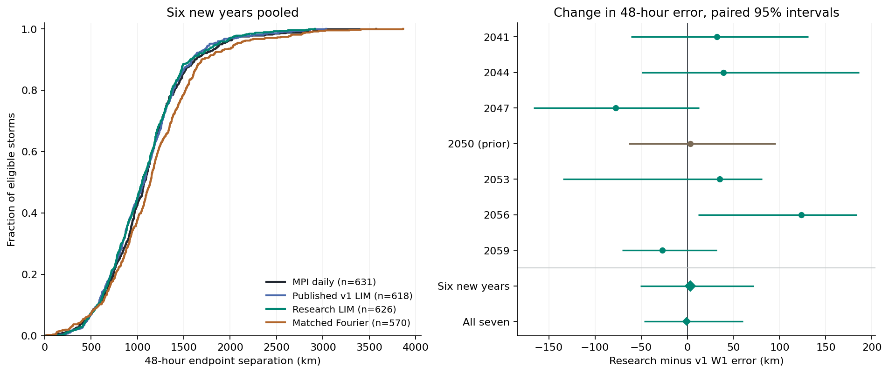
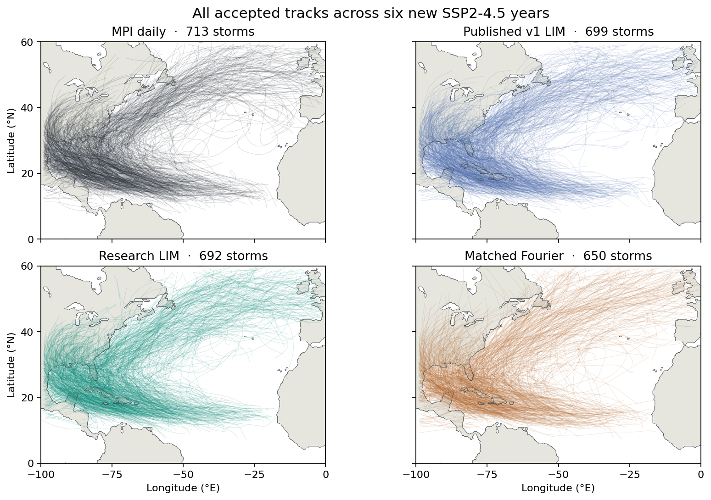

# Six additional years of MPI-driven North Atlantic storms

We asked whether the small increase in Research LIM’s 48-hour displacement error in 2050 repeats in nearby years. The primary comparison pools six new SSP2-4.5 years from MPI-ESM1-2-LR. Each driver sees the same proposed disturbances. The reference runs the same coupled FAST tropical cyclone model with MPI daily 250 and 850 hPa winds. These are synthetic storms in one climate model. [Executed tutorial, section 9](../../../notebooks/FaIR_EOF_LIM_to_Tropical_Cyclones.ipynb)

## What the additional years show

Across the six new years, the 48-hour W1 is **29.65 km for published v1 and 32.98 km for Research** on the same MPI monthly background. The paired change is **+3.33 km** (95% interval **−50.69 to +71.96 km**). Research wins in 2047 and 2059, and v1 wins in the other four. Including 2050 yields 25.72 and 24.96 km and reverses the sign of the small pooled difference. With warming alone, the six-year change is +1.27 km (−42.98 to +63.02 km).

Matched Fourier gives 73.62 km, and native Fourier gives 91.56 km in the six-year pool. Research’s change from matched Fourier is −40.64 km (−106.17 to +63.66 km), and v1’s change from native Fourier is −61.91 km (−117.68 to +43.13 km). Both LIM point estimates are closer to the reference in the pooled distribution. The year-specific reversals and paired uncertainty leave the advantage uncertain across individual years.

The largest annual Research–v1 gap occurs in 2056. Research storms have a median 48-hour endpoint separation of 936 km, compared with 1,087 km for MPI and 1,125 km for v1. Their 90th percentiles are 1,393, 1,605, and 1,614 km, respectively. The 2056 discrepancy is a shift toward shorter endpoint separations. These distributions also reflect which storms supply a complete window.

In the six-year fixed-background sample, 713 MPI-driven, 699 v1, and 692 Research disturbances become TCs. There are 631, 618 and 626 complete displacement windows. Research reduces lifetime peak-wind W1 from 1.93 to 1.16 m/s. The paired difference of −0.76 m/s has a 95% interval of −2.59 to +1.55 m/s. The clearest gains occur in the environmental maps. Mixed-layer depth RMSE falls by 5.07 m, and conditional monthly steering RMSE by 0.062 m/s. Both field intervals lie below zero.

### First 48 hours on the fixed MPI background

Each W1 is a distance to the MPI-driven storm distribution, in kilometres. The three storm counts give the eligible 48-hour windows in MPI, v1 and Research order.

| Year | Warming (K) | Eligible MPI / v1 / Research | v1 W1 | Research W1 | Matched Fourier W1 | Research − v1 [95% interval] |
|---|---:|---:|---:|---:|---:|---:|
| 2041 | +1.63 | 108 / 137 / 128 | 61.8 | 93.8 | 62.2 | +32.1 [-61.1, +131.3] |
| 2044 | +1.65 | 113 / 101 / 99 | 57.4 | 96.4 | 73.8 | +38.9 [-49.2, +186.4] |
| 2047 | +1.73 | 122 / 109 / 114 | 122.2 | 44.8 | 99.5 | -77.5 [-166.6, +12.9] |
| 2050 (previous) | +1.80 | 103 / 106 / 86 | 92.1 | 95.5 | 206.7 | +3.4 [-63.4, +95.9] |
| 2053 | +1.84 | 116 / 85 / 96 | 61.7 | 96.6 | 175.6 | +35.0 [-134.5, +81.2] |
| 2056 | +1.91 | 70 / 94 / 84 | 62.7 | 186.1 | 145.3 | +123.4 [+12.0, +183.4] |
| 2059 | +2.02 | 102 / 92 / 105 | 80.3 | 53.3 | 157.7 | -27.0 [-70.7, +31.8] |
| **Six new years** | +1.63 to +2.02 | 631 / 618 / 626 | 29.6 | 33.0 | 73.6 | +3.3 [-50.7, +72.0] |
| All seven years | +1.63 to +2.02 | 734 / 724 / 712 | 25.7 | 25.0 | 88.1 | -0.8 [-46.6, +60.4] |



### Other storm outcomes in the six new years

| Monthly inputs | Metric | v1 error | Research error | Research − v1 [95% interval] |
|---|---|---:|---:|---:|
| MPI background | 48-hour displacement W1 (km) | 29.65 | 32.98 | +3.33 [-50.69, +71.96] |
| MPI background | Lifetime peak-wind W1 (m/s) | 1.93 | 1.16 | -0.76 [-2.59, +1.55] |
| MPI background | Formation rate error (per 100) | 0.013 | 0.019 | +0.006 [-0.118, +0.088] |
| MPI background | Landfall rate error (per 100) | 0.017 | 0.020 | +0.003 [-0.083, +0.071] |
| warming only | 48-hour displacement W1 (km) | 37.83 | 39.10 | +1.27 [-42.98, +63.02] |
| warming only | Lifetime peak-wind W1 (m/s) | 1.11 | 1.48 | +0.38 [-1.18, +2.15] |
| warming only | Formation rate error (per 100) | 0.069 | 0.156 | +0.087 [-0.054, +0.179] |
| warming only | Landfall rate error (per 100) | 0.053 | 0.143 | +0.090 [-0.039, +0.177] |



### Conditional steering and ocean reconstruction

| Field | v1 RMSE | Research RMSE | Research − v1 [95% interval] |
|---|---:|---:|---:|
| Subsurface gradient (K per 100 m) | 0.666 | 0.509 | -0.157 [-0.168, -0.146] |
| Mixed-layer depth (m) | 24.274 | 19.201 | -5.073 [-6.492, -3.766] |
| Monthly mean steering (m/s) | 0.846 | 0.784 | -0.062 [-0.068, -0.057] |
| Sea surface temperature (K) | 0.429 | 0.323 | -0.106 [-0.114, -0.100] |

## Experiment

We selected 2041, 2044, 2047, 2053, 2056 and 2059 at three-year intervals around the previously examined year. No checkpoint was refitted and the years were registered before comparing their storm outcomes. Eight MPI initial-condition members were reserved for testing throughout. For each year, each member supplies every calendar month, two 15-day windows starting on days 5 and 12, and 96 proposed disturbances per start. This gives 18,432 attempts per driver and year, or 110,592 over the six years. A common proposal has the same date, member, position, genesis random variate and initial wind speed across drivers. [Registered design](../../../experiments/annual_refinement/midcentury_plan.json) · [Registration and checkpoint fingerprints](registration.json)

The fixed-background comparison holds MPI’s monthly ocean and atmospheric maps in common. Published v1 and Research provide daily LIM winds. The native Fourier driver uses v1 wind moments, and the matched Fourier driver uses Research wind moments. Both Fourier controls follow the TC package’s native sampling convention, drawing phases independently for each proposed storm. The MPI and LIM winds are shared across disturbances in the same weather window. In the warming-only comparison each LIM draws both the background and the weather, conditional on the scenario-year warming. The forcing is the area-weighted global annual MPI near-surface air temperature, averaged with actual month lengths over the 35 training members and referenced to their 1850–1900 mean of 13.5074 °C. We reproduced the original 2050 value of +1.79905 K. The new years span +1.63 to +2.02 K. [Annual temperatures](forcing.csv) · [Training-member temperatures](forcing_members.csv) · [Pinned CMIP6 sources](cmip6_files.csv)

## How to read the scores

- A displacement is the great-circle separation of the endpoints of a 48-hour window, starting with the storm’s first six-hourly wind of at least 18 m/s. All nine fixes must be finite and within 0–60°N, 100°W–0°. Accepted storms without a complete window still enter the rate and lifetime peak-wind calculations.
- For displacement and lifetime maximum intensity, W1 is the integral of the absolute gap between the MPI-driven and model cumulative distributions. Its units are km and m/s, respectively. We pool the raw eligible storms before computing a multiyear W1. A year’s contribution to the pooled distribution depends on its eligible storm count. Yearly W1 values answer a separate question about performance in a single year.
- Formation and landfall use the absolute difference between the two rates per 100 **proposed disturbances**. A paired change is the Research error minus the comparator error unless the model column names v1. Negative values mean the first model reduced the error.
- The 95% percentile interval uses 2,000 paired resamples. For a pooled result we draw whole members and whole years with replacement on two crossed axes, using identical multiplicities for all models. One-year intervals resample the eight members. The two start dates, twelve months and stochastic outcomes of a given member-year stay together. The interval describes sensitivity within this model and seeding experiment. [Yearly and pooled scores](scores.csv) · [Paired changes](contrasts.csv) · [Raw counts](counts.csv)

## Reproduce the storm comparison

The two new Parquet files contain all six years of proposals and six-hourly positions. The 2050 sensitivity reads the previously published archive. Starting from a checkout with the [tutorial dependencies](../../../requirements-notebook.txt), these commands validate the shared proposals, reconstruct every accepted track’s 48-hour displacement, repeat the paired resampling and regenerate the figures. They do not need the CMIP6 input fields or the fitted weights.

```bash
export PYTHONPATH="$PWD/src"
export OPENBLAS_NUM_THREADS=2 OMP_NUM_THREADS=2
python experiments/annual_refinement/midcentury_score.py
python experiments/annual_refinement/midcentury_figures.py
```

[Six-year attempts](attempts.parquet) · [Six-hourly tracks](tracks_6h.parquet) · [Integrity checks](checks.json) · [Original 2050 attempts](../data/annual_mpi2050_attempts.parquet)

To repeat the integrations, install the two frozen [weight sets](../../../README.md), use the published CMIP6 manifest, and run the commands below from the repository root. The preprocessing reads an available local mirror first and otherwise uses HTTPS range requests against the pinned CMIP6 releases. Each of the 48 climate tasks handles a complete member-year. The 80 storm shards cover five wind drivers. Each LIM shard integrates both protocols. On a cluster the shards can be submitted as arrays using the supplied [data job](../../../experiments/annual_refinement/midcentury_data.pbs) and [storm job](../../../experiments/annual_refinement/midcentury_storms.pbs). Set `TC_MIDCENTURY_WORK` to choose another scratch directory.

```bash
export PYTHONPATH="$PWD/src"
export OPENBLAS_NUM_THREADS=1 OMP_NUM_THREADS=1
python experiments/annual_refinement/midcentury_prepare.py forcing --workers 5
for index in $(seq 0 47); do
  python experiments/annual_refinement/midcentury_prepare.py prepare --index "$index"
done
for index in $(seq 0 79); do
  python experiments/annual_refinement/midcentury_storms.py --index "$index" \
    --base weights --research work/refined_weights --workers 3
done
python experiments/annual_refinement/midcentury_score.py --archive
for month in $(seq 1 12); do
  python experiments/annual_refinement/midcentury_fields.py --month "$month" \
    --base weights --research work/refined_weights
done
python experiments/annual_refinement/midcentury_fields.py
python experiments/annual_refinement/midcentury_figures.py
```

One of the 774,144 new driver/protocol attempts needed a shorter integration step. On 12 December 2044, a trial solver stage for seed 53 of member r37i1p1f1 crossed the eastern wind halo in the warming-only Research run. The same disturbance and winds were reintegrated with a 90-minute cap. A separate 45-minute run returned the same basin-exit classification and peak wind (9.414 m/s). The disturbance is included in the formation denominator and reached neither the TC threshold nor landfall. The fixed-background benchmark had no such retry. [Boundary sensitivity](boundary_retry.json) · [Repeat the single-seed check with the released weights](../../../experiments/annual_refinement/midcentury_boundary_check.py)

The additional field diagnostic computes the RMSE of each frozen basis’s reconstructed sea surface temperature, mixed-layer depth and subsurface gradient on grid cells covered by both bases and MPI. The conditional monthly steering diagnostic compares the model’s mean wind given MPI’s monthly background with the actual monthly mean of the MPI daily winds. Both use standard cosine-latitude area weights inside the basin. We average squared error across months, members and years before taking a square root. These comparisons use all member-months, independently of which ones produce storms. [Field scores](field_scores.csv) · [Member-month squared errors](field_cases.parquet) · [Input month fingerprints](prepared_months.csv)
