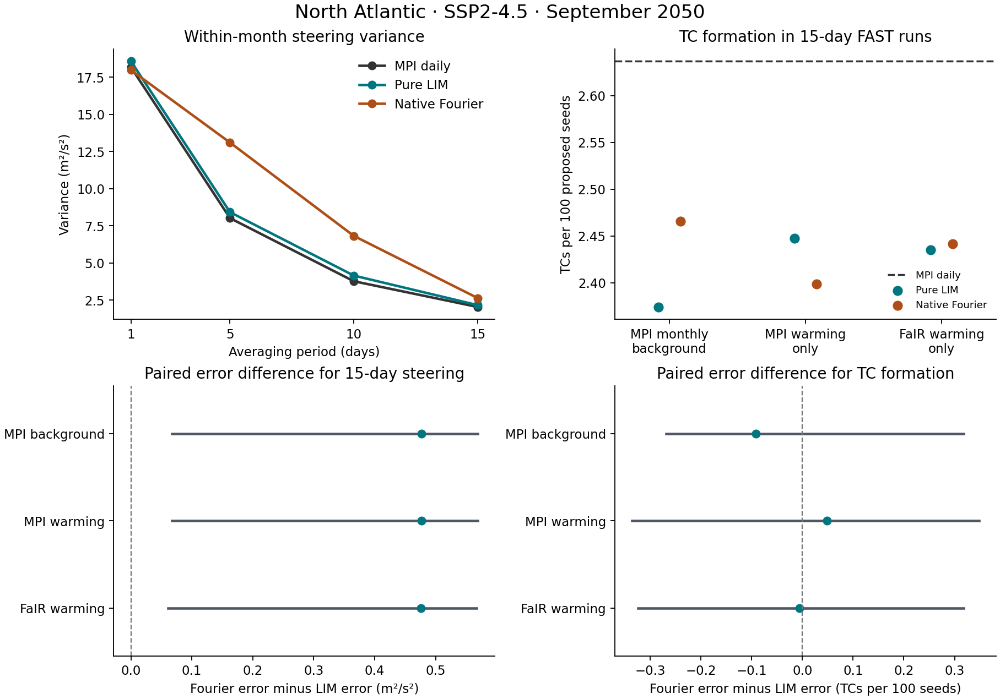
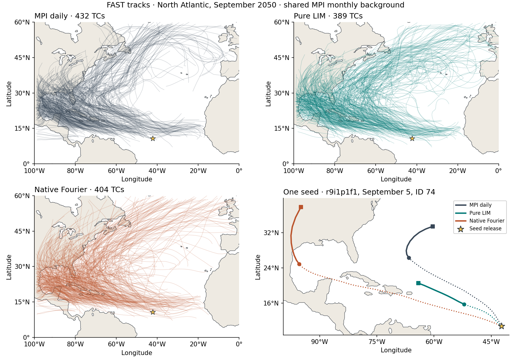

# How well does the emulator reproduce MPI weather and tropical cyclones in September 2050?

For the North Atlantic under SSP2-4.5, the frozen pure LIM reproduces multiday steering and the distribution of 48-hour storm displacement more closely than the TC package's native Fourier weather. Formation and landfall rates give a less decisive result. With the FaIR warming input, MPI daily winds produced 432 tropical cyclones in 16,384 proposed seeds, compared with 399 from LIM and 400 from Fourier. The target here is MPI weather passed through the same Coupled FAST solver. [MPI SSP2-4.5 data](https://doi.org/10.22033/ESGF/CMIP6.6693)

## Following one seed through the comparison

We start with one September from each of the eight MPI initial-condition members reserved for testing. Training used 35 other members under historical forcing and SSP5-8.5. SSP2-4.5 was held out as a scenario. Its 2050 warming falls inside the September training range of −0.012 to +3.420 K. The same calendar year occurs in SSP5-8.5 training for different members. This experiment tests transfer to a new scenario and new weather realizations in the North Atlantic peak season. [Member split](../../configs/annual_lim/members.json) · [Experiment design](design.json)

For the reference, FAST sees each member's actual 30 daily mean eastward and northward winds at 250 and 850 hPa. It also receives that member's monthly sea surface temperature, mixed-layer depth, sub-mixed-layer cooling gradient, surface pressure and atmospheric profiles. Winds are interpolated linearly between daily centres. The model releases disturbances at noon on September 5 and 14 and integrates them for up to 15 days. The two windows overlap. Every comparison shares the seed locations, initial intensities and random screening values. The reference storms are synthetic FAST outcomes in a climate model's environment. [CMIP6 files, versions and published hashes](cmip6_files.csv) · [Direct checks at native wind grid points](raw_checks.json)

| What the two generators receive | What is being tested |
| --- | --- |
| MPI monthly background and MPI annual warming | Encode each target member's thermodynamic background. Both drivers receive the same model-predicted mean wind and same pointwise four-component covariance specification. This isolates the weather generator conditional on the monthly environment. |
| MPI annual warming only | Sample a new monthly background from the frozen weights and give it to both drivers. The 35 fitting-member identities under SSP2-4.5 give a global annual mean of 15.3064 °C in 2050. Subtracting the training baseline of 13.5074 °C gives **+1.7991 K**. |
| FaIR annual warming only | Run the same sampling procedure with **+1.8132 K** from FaIR SSP2-4.5 configuration 2451. All random streams are shared with the MPI-warming experiment. This is the tutorial's deployment setting. |

The MPI annual mean uses grid-cell areas and month lengths. The eight evaluation members do not enter that forcing average. Each member has 32 generated months per weather driver for wind diagnostics. Four of those months carry tracks at both start dates, with 256 proposed seeds per panel. All rates are per 100 proposed seeds. An annual cyclone count requires a separate calibration of how often to release seeds. [MPI warming calculation](forcing.json) · [FaIR calculation](../fair_to_tc/run.json) · [Attempts and denominators](counts.csv)

## Explore the trajectories in the notebook

Sections 5–6 run one seed under three drivers and display the 432 MPI, 389 LIM and 404 Fourier tracks from the shared-background experiment. The zoom follows the first seed with a complete 48-hour window under all three drivers, in the first member of the published test split. The example was selected by availability. [Executed English notebook](../../notebooks/FaIR_EOF_LIM_to_Tropical_Cyclones.ipynb) · [Inputs to each FAST run](../annual_lim_tc_flow.png) · [Regional MPI input and provenance](../../notebooks/data/README.md)

Each row of the track archive is one six-hourly position from release to the last available fix of an accepted TC. Join to the all-seed outcomes on `protocol`, `method`, `member`, `draw`, `origin` and `seed_id`. Position columns are `lon_e` in degrees east and `lat_n` in degrees north. `elapsed_h` counts hours from release and `vmax_ms` gives maximum surface wind in m/s. The archive contains **118,471 fixes on 3,242 accepted tracks** across the reference and seven main driver/input combinations. The native target-month wind-moments sensitivity has its own outcomes table. [Six-hourly tracks](tc_tracks_6h.parquet) · [All proposed seeds](attempts.parquet)

The tutorial recalculates the 48-hour displacement from those coordinates, checks it against the archived per-storm outcome, and recomputes the 5,000 paired whole-member bootstrap replicates. The figures show how the ranking changes with the metric and the climate inputs. [Displacement distributions](mpi_displacement_cdf.png) · [Steering and paired intervals](mpi_skill_intervals.png)

## Which quantities are closer?

The table holds the MPI monthly thermodynamic background fixed. For steering, we form the vector 0.2 × upper-level wind + 0.8 × lower-level wind at each grid point, remove that month's local mean, average across consecutive days, then take the mean squared anomaly over both components and the area-weighted basin. The table measures variability **within** September. The annual model report also measures variation **between** different months and backgrounds. [Annual variance definition and results](../annual_lim_results.md)

| Quantity | MPI reference | Pure LIM | Native Fourier | Fourier error minus LIM error, paired 95% interval |
| --- | ---: | ---: | ---: | ---: |
| 1-day steering variance (m²/s²) | 18.173 | 18.577 | 17.982 | −0.214 [−0.783, 1.055] |
| 5-day steering variance (m²/s²) | 8.019 | 8.421 | 13.103 | 4.682 [4.091, 5.110] |
| 10-day steering variance (m²/s²) | 3.772 | 4.152 | 6.821 | 2.669 [2.270, 2.915] |
| 15-day steering variance (m²/s²) | 2.041 | 2.164 | 2.641 | 0.477 [0.067, 0.569] |
| Zonal steering anomaly correlation, 7.5° apart | 0.482 | 0.614 | 0.992 | 0.378 [0.375, 0.381] |
| 90th percentile of daily shear (m/s) | 20.883 | 19.606 | 19.647 | −0.041 [−0.305, 0.231] |
| Three consecutive weak-shear days (% of three-day windows) | 18.25 | 17.61 | 23.49 | 4.60 [−1.30, 6.22] |
| Formations per 100 seeds | 2.637 | 2.374 | 2.466 | −0.092 [−0.269, 0.318] |
| TC landfalls per 100 seeds | 2.057 | 1.715 | 1.910 | −0.195 [−0.323, 0.305] |
| Median lifetime maximum wind among accepted TCs (m/s) | 37.49 | 35.08 | 33.87 | 0.76 [−0.96, 2.19] |
| Median 48-hour displacement (km) | 926 | 1,007 | 1,156 | 108 [54, 156] |

A positive error difference favours LIM. Each scalar error is the absolute difference between an ensemble mean and the reference mean. For the two storm distributions in the last rows, the reported levels are medians and the errors are the **Wasserstein-1 distances across all quantiles**. For displacement these distances are **116 km for LIM and 224 km for Fourier**. The 48-hour window begins at the first six-hourly maximum wind of at least 18 m/s and requires nine consecutive in-domain fixes. The MPI, LIM and Fourier groups have 370, 345 and 346 qualifying storms. Landfall counts require an accepted TC with an onshore crossing at tropical-storm strength. [Full scores including distribution distances](scores.csv) · [Member-level measurements](member_metrics.csv)

Spatial correlation and shear are evaluated over ocean between 10–30°N and 80–20°W. The correlation pools paired local steering anomalies over time, east/west point pairs and both components. Daily deep shear is the magnitude of the vector difference between the two levels. Its 90th percentile uses area weights within each month. A weak-shear window stays below 8 m/s for all three days. The native sampler uses four random time series for one storm, assembled from 15 harmonics on a 20-day fundamental period, and mixes them through a local covariance matrix that varies in space. This gives nearby locations similar time histories. LIM evolves 120 joint spatial wind modes. The two-point statistic measures how much of that similarity each method produces. [Upstream Fourier implementation](../../vendor/tropical_cyclone_risk/track/bam_track.py) · [Regional weather-model derivation](../annual_lim_linear_algebra.md)

For uncertainty we resample the **eight whole members** 5,000 times, keeping their seed panels, overlapping starts and weather draws together across methods. Each interval concerns one metric and is conditional on this September, the available members, the fixed experiment and the downscaling model. Thousands of seeds reduce storm Monte Carlo noise while the number of independently sampled climate histories remains eight. We compare distributions across disturbances because each generator draws its own weather realization. [Paired scoring code](../../notebooks/score_mpi2050.py)

## What happens in the FaIR deployment setting?

| Quantity | MPI daily + FAST | FaIR → LIM + FAST | FaIR → Fourier + FAST |
| --- | ---: | ---: | ---: |
| TCs / 16,384 seeds | 432 | 399 | 400 |
| TC landfalls / 16,384 seeds | 337 | 283 | 303 |
| Median 48-hour displacement (km) | 926 | 947 | 1,125 |
| 48-hour displacement distribution distance to MPI (km) | 0 | 31.8 | 229.8 |
| Lifetime maximum wind distribution distance to MPI (m/s) | 0 | 1.81 | 2.96 |

For displacement the paired reduction in distribution distance is **198.0 km [72.4, 215.6]**. For formation it is **−0.006 [−0.324, 0.317] TCs per 100 seeds**. For landfall it is **−0.122 [−0.415, 0.238] per 100**. Using MPI's own warming with sampled backgrounds gives displacement distances of 31.7 and 231.8 km. In this experiment the 0.014 K difference between the two warming inputs has little effect on the displacement ranking. The FaIR tutorial's earlier 32 versus 22 TCs came from 1,024 seeds per driver, without a future-weather reference. [All input conditions](scores.csv) · [Tutorial panel counts](../fair_to_tc/tc_counts.csv)

## Two checks on the Fourier comparison

1. **Put Fourier on MPI's daily clock.** With the MPI background fixed we integrated each storm's native Fourier factors over each UTC day, then interpolated those daily means to the solver clock, using the same phases as the hourly run. This gives 424 formations and 329 landfalls, compared with 404 and 313 for native hourly Fourier, 389 and 281 for LIM, and 432 and 337 for MPI. The displacement distribution distances are 222 km for daily Fourier, 224 km for hourly Fourier, and 116 km for LIM. Daily MPI winds provide a reference for this daily-driven pipeline. Higher-frequency winds or historical observations are needed to evaluate subdaily intensity physics. [All counts](counts.csv) · [Solver inputs](../../notebooks/benchmark_mpi2050.py)
2. **Give both drivers the target month's actual wind statistics.** This additional diagnostic emulates the native package's use of grid-point means and covariances estimated from MPI daily winds. For LIM we transform its anomaly field at each point by the MPI Cholesky factor times the inverse model factor, then add MPI's mean. The native estimator uses the sample covariance off-diagonal and the population variance on the diagonal. Six of 16,704 member-grid cells have an indefinite matrix and use the package's zero-wind fallback at the grid point. With this additional information, the 90th-percentile shear becomes 20.62 m/s for LIM and 20.78 m/s for Fourier, against 20.88 in MPI. Displacement distances are 63 and 142 km, with a paired advantage of 79 km [3, 140] for LIM. Formations are 365 and 330, against 432 in MPI. Supplying the target month's wind statistics would require external data in deployment. These runs are a diagnostic of the role of local mean and covariance. [Additional driver runs](attempts_moments.parquet) · [Wind draws](weather_moments.csv)

## A simple improvement tested on other members

We separated the steering vector from the deep-layer shear vector. Let $U$ and $L$ be the two-component 250 and 850 hPa winds. Define $S=0.2U+0.8L$ and $D=U-L$. The inverse is $U=S+0.8D$ and $L=S-0.2D$. If $\mu_D$ is the conditional mean shear **vector** at that grid point, a one-parameter correction is $D'_t=\mu_D+a(D_t-\mu_D)$. Reconstructing the two levels with $D'_t$ preserves $S$ at every time and grid point. FAST itself uses intensity-dependent steering weights, so this algebraic identity applies to the fixed-weight wind diagnostic.

We fitted $a=1.0944$ using **525 training Septembers**. It is the square root of the ratio of the MPI and LIM within-month shear variances in the ocean corridor. An alternative adds a one-day lag to the shear anomaly and fits both its variance and the mean squared daily increment. Its fitted gain is 1.0872 and its lag coefficient is 0.0099. All coefficients use training data. Both candidates were evaluated on **42 validation Septembers** from seven different members and six different years, with 16 weather draws per background. The following are averages over those member-months. [Fitting code](../../notebooks/validate_shear_gain.py) · [Coefficients](gain_fit.json) · [Validation scores and crossed member/year intervals](gain_scores.csv)

| Validation metric | MPI | Existing LIM | Shear gain | Shear gain plus one lag |
| --- | ---: | ---: | ---: | ---: |
| Within-month variance per shear component (m²/s²) | 45.48 | 38.24 | 45.80 | 45.80 |
| Mean squared daily change per shear component (m²/s²) | 30.46 | 25.91 | 31.03 | 30.64 |
| 90th-percentile shear magnitude (m/s) | 20.60 | 19.40 | 20.35 | 20.35 |
| Ocean grid-days with shear below 8 m/s (%) | 36.09 | 37.86 | 35.34 | 35.34 |
| Three consecutive weak-shear days (%) | 16.68 | 17.32 | 14.53 | 14.60 |

The single gain reduces the absolute 90th-percentile error by 0.95 m/s [0.47, 1.03], but the three-day weak-shear frequency moves farther from MPI. One global lag coefficient has little effect on those spells. These are development results. All 2050 comparisons above use the released weather dynamics.

For the next iteration, the most informative target is whether a disturbance experiences a **sustained favourable environment along its early path**. With MPI thermodynamics fixed, 1,132 proposed seeds are screened out by ventilation in the reference, 1,171 in LIM and 1,213 in Fourier. Of the seeds that enter integration, 6.69%, 6.06% and 6.33% become accepted TCs. I would measure 2–5-day low-shear spells along MPI-driven candidate paths, stratified by initial potential intensity and 600 hPa humidity. A small next model could keep the steering dynamics and fit separate shear-anomaly amplitudes and persistence for a few leading modes, regularized toward the existing fit. Validate both spell frequency and TC formation before selecting it. For a claim about mid-century risk, reserve fresh ensemble members and multiple neighbouring years and active-season months for the final comparison. Adding more seeds to the same eight Septembers cannot measure that climate variability. [Per-seed screening outcomes](attempts.parquet)

## Reproduction

A second complete run from the public checkout reproduced all 163,840 per-seed records and all 2,056 monthly diagnostic rows exactly in the reference numerical environment. Direct reads at 72 native MPI wind coordinates also matched the regional input arrays. [Reproduction checks and environment](reproducibility.json)

With the release weights and notebook dependencies installed, the following commands can be run from the repository root. The first command uses the saved per-attempt and weather-draw data to reproduce the figure, scores and intervals without downloading climate data.

~~~bash
export PYTHONPATH="$PWD/src"
export OPENBLAS_NUM_THREADS=1 OMP_NUM_THREADS=1 MKL_NUM_THREADS=1
python notebooks/score_mpi2050.py --work reports/mpi2050 --output runs/mpi2050/from_published
~~~

To rebuild the reference, fetch the pinned CMIP6 hyperslabs, then rerun the three main protocols and the additional target-moments diagnostic. The preprocessing step accepts an optional local CMIP6 mirror via `--mirror`. Results are written under `runs/mpi2050/`.

~~~bash
python notebooks/prepare_mpi2050.py --workers 4
python notebooks/benchmark_mpi2050.py --workers 4
python notebooks/benchmark_mpi2050.py --workers 4 --mpi-wind-moments
python notebooks/score_mpi2050.py
~~~

The optional shear calibration reads the original annual preprocessing output. Point `--annual-work` to the directory containing its `prepared/` tree. The main 2050 benchmark runs directly from its own SSP2-4.5 inputs.

~~~bash
python notebooks/validate_shear_gain.py --annual-work runs/annual_lim --workers 4
python notebooks/score_mpi2050.py
~~~
